# Charts and Group By

[← Contents](README.md)

TableSkim draws charts of the rows you are looking at and summarizes them
in tables, without a spreadsheet or a script. This page shows, with
examples, which tool answers which question, how to read the result, and
how to go from a chart to the rows behind it. The examples use the demo
files `normal.csv` (54 people, with the first row as header) and
`large.parquet` (10,000 rows).

- [Which tool for which question](#which-tool-for-which-question)
- [How one column is distributed: histograms](#how-one-column-is-distributed-histograms)
- [How two columns relate: scatter plots and density](#how-two-columns-relate-scatter-plots-and-density)
- [How groups differ: box plots](#how-groups-differ-box-plots)
- [Summarizing in a table: Group By](#summarizing-in-a-table-group-by)
- [From a chart to the rows](#from-a-chart-to-the-rows)
- [Saving charts as images](#saving-charts-as-images)
- [In the terminal UI](#in-the-terminal-ui)

## Which tool for which question

| Question                                             | Tool                     | GUI                         | TUI |
| ---------------------------------------------------- | ------------------------ | --------------------------- | --- |
| What values does a column hold, and how many of each? | Histogram                | Edit → Histogram...         | `B` |
| Are two number (or date) columns related?            | Scatter plot, density    | Edit → Scatter Plot...      | `M` |
| How does a number differ between groups?             | Box plot                 | Scatter Plot, text on X     | `M` |
| How many rows, and what totals or averages, per group? | Group By               | Edit → Group By...          | `A` |
| Minimum, maximum, mean of one column?                | Column statistics        | Edit → Column Statistics    | `S` |

Every tool works on the **current view**: the rows left by the filter. So
you can filter first (for example to one year) and then chart or group
just those rows; the charts follow when the filter changes.

## How one column is distributed: histograms

A histogram counts how many values fall into each range ("bin") of a
column. Put the current cell in the column and choose **Edit →
Histogram...** (`Ctrl+Shift+H`).

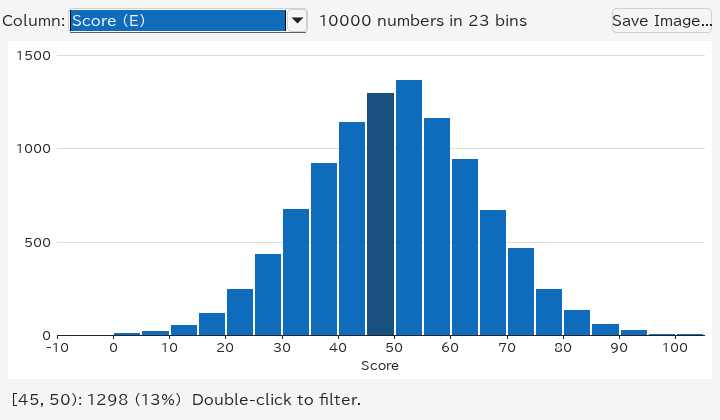

How to read it:

- The **shape** tells how the values are spread. Here the scores form a
  bell around 50: most rows score 35 to 65, and very low or very high
  scores are rare.
- The **summary** at the top says what was counted: "10000 numbers in 23
  bins". Empty cells and values of another kind are counted apart.
- **Point at a bar** for its exact range and count, such as `[45, 50):
  1298 (13%)`: 1298 rows, 13% of them, have a score of at least 45 and
  less than 50.

Dates are counted into whole days, months or years; a column of text shows
its most frequent values instead, longest bar first. See
[Histograms](gui.md#histograms) for every option and
[How bins are chosen](filtering.md#how-bins-are-chosen) for the details.

## How two columns relate: scatter plots and density

A scatter plot draws one point per row, with one column across (X) and
another up (Y). Choose **Edit → Scatter Plot...** (`Ctrl+Shift+P`). Select
two columns first to plot exactly those (the first one is X); otherwise
TableSkim picks number or date columns near the current cell, and you can
change them in the **X** and **Y** lists.

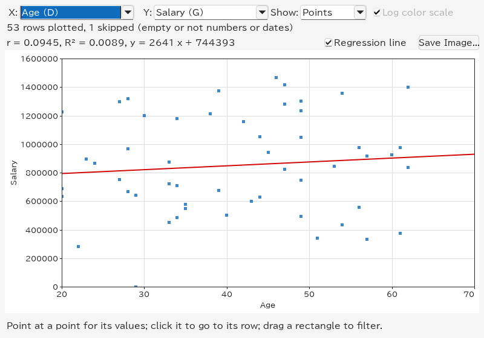

How to read it:

- The line above the plot measures the relation. **r** (Pearson's
  correlation coefficient) runs from −1 to 1: near 1, Y rises with X; near
  −1, Y falls as X rises; near 0, there is no straight-line relation. Here
  `r = 0.0945`: age says almost nothing about salary.
- **R²** is the share of Y's variation that the line explains (here less
  than 1%), and `y = 2641 x + 744393` is the line itself, drawn in red: on
  average, a year of age goes with 2641 more salary.
- **Point at a point** to see its values and row; **click it** to jump to
  that row in the sheet.

With many rows, points pile up on each other. **Show → Density** counts
the rows in a grid instead, and colours each cell from dark (few rows) to
yellow (many):

The yellow band shows where most rows lie (scores around 50, whatever the
value). **Log color scale** keeps cells with a handful of rows visible next
to the busiest ones; turn it off to compare counts linearly.

## How groups differ: box plots

When X is a column of text, such as a department, each of its values
becomes a group with a column of its own, and the plot shows a **box plot**
per group. Here: salaries by department.

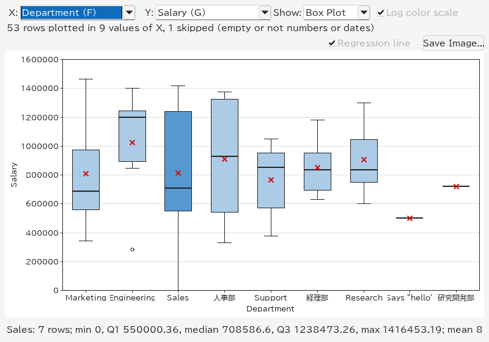

How to read a box:

- The **box** holds the middle half of the group's values: from the first
  quartile (a quarter of the values are below it) to the third (three
  quarters are below it). A tall box means widely spread values.
- The **thick line** in the box is the **median**: half the values are
  below it, half above. The red **×** is the **mean**; when it lies far
  from the median, a few very high or low values pull it.
- The **whiskers** reach the lowest and highest values that are not
  unusual (within 1.5 box heights of the box). **Rings** beyond them are
  **outliers**: here one engineer earns far less than the others.
- **Point at a box** to read its numbers below the plot: count, minimum,
  quartiles, maximum and mean.

Engineering has the highest median, 人事部 the widest spread; departments
with one person (`研究開発部`) show only a line. Up to 30 groups are shown,
the largest first; the rest are drawn together as **(other)**.

For a group with more than 1,048,576 values, the box statistics are estimated
from a uniform sample of that many values. The displayed row count still
includes the whole group; the sample size and an estimate label appear with
the box's numbers. Minimum, maximum and outlier counts also describe the
sample. Density counts use all rows. The sample is the same whether points
are retained or only the density is calculated.

When groups do not differ, the boxes look alike, as for the five
categories of `large.parquet`, which were generated the same way:

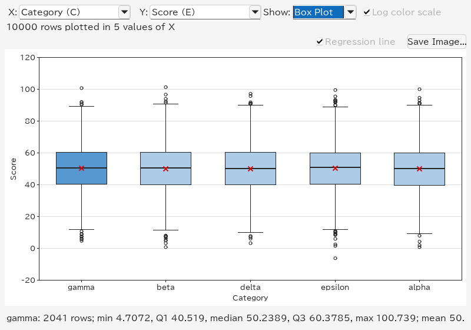

**Show → Density** shows each group's histogram as a column of coloured
cells, which tells more about the shape than a box (two peaks, say):

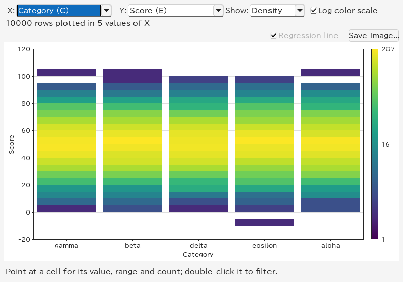

## Summarizing in a table: Group By

Charts show patterns; **Group By** gives the numbers. **Edit → Group
By...** (`Ctrl+Shift+G`) asks which columns to group by and which to
summarize, and puts the result in a new sheet named **Group By**.

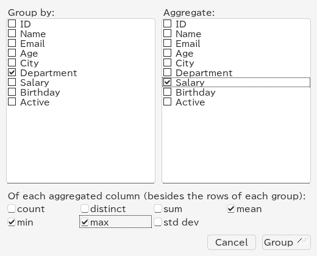

### Counting rows per group

Check only a column to group by and press **Group**: the result has one row
per value with its **count**. Sort the **count** column (click its sort
button twice) to see the largest groups first:

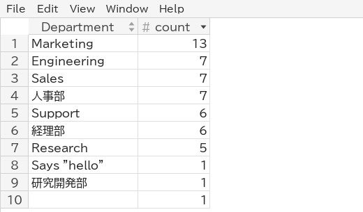

The empty last row counts the rows without a department.

### Means, minimums and maximums per group

Check columns under **Aggregate** and the functions below: **count**
(values that are not empty), **distinct** (different values), **sum**,
**mean**, **min**, **max** and **std dev** (standard deviation). Each
aggregated column and function gives a column such as `Salary mean`. Means
often have many decimals; **Format** in the column header menu shows them
rounded, with thousands separators:

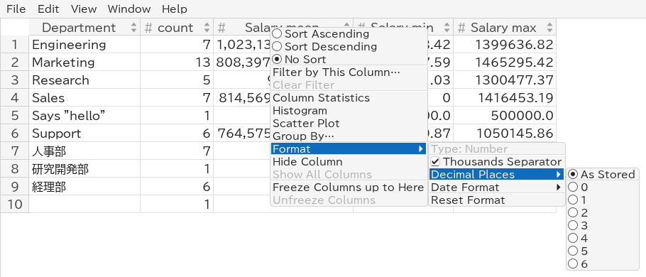

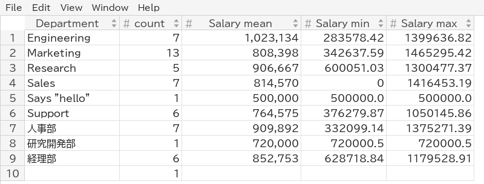

The `Says "hello"` row shows how text is handled: its salary is the text
`500000.0`, which counts as a number for the mean but is kept as written
for **min** and **max**.

### Totals of the whole sheet

Leave every **Group by** column unchecked: all rows form one group, and the
result is one row of totals:

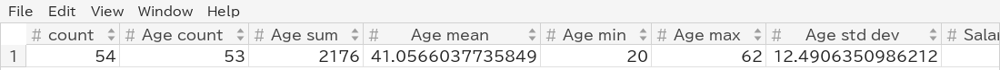

### Grouping by several columns

Check two or more **Group by** columns to count each combination, for
example City and Department: a row for each department in each city.

### Working with the result

The **Group By** sheet is an ordinary sheet: sort it, filter it, chart it
(a histogram of `count`, say), copy it, or save it with **File → Export
View...**. Grouping again replaces it. It stays when the file is reloaded,
but it does not change when the original sheet does; group again after
changing the filter. See [Group By](filtering.md#group-by) for how values
are compared.

## From a chart to the rows

Charts and filters work together, so you can drill down step by step:

- **Double-click** a histogram bar, a density cell or a box to filter the
  sheet to its rows; **drag a rectangle** in a scatter plot of numbers to
  filter to the rows inside it.
- The chart is then drawn again for the rows left, so you can narrow down
  further.
- **Edit → Clear Filter** goes back to all rows.

Double-clicking the Engineering box above leaves the seven engineers:

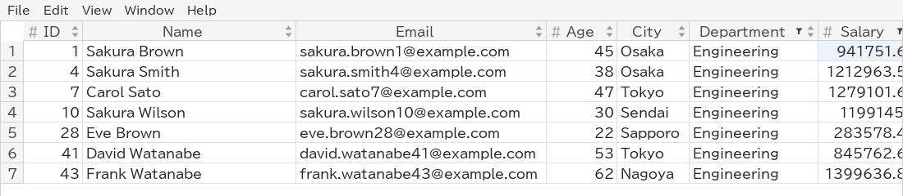

## Saving charts as images

**Save Image...** in the histogram and scatter plot windows writes the
chart as shown, with its axis titles, to a file:

- **PNG** (`.png`): a picture at the size of the window, for slides,
  documents and chat.
- **SVG** (`.svg`): lines and text stay sharp at any size, and the file
  can be edited in a vector drawing program. The points of a scatter plot
  are a picture inside it.

The type follows the extension you type, or the type chosen in the file
dialog. Resize the window first to change the size of the image.

## In the terminal UI

The terminal UI has the same tools, drawn with characters:

- `B` shows a histogram of the cursor's column; `Enter` filters to a bar.
- `M` shows the density of two columns (select them first), or box plots
  when X holds text; `b` switches between the box plots and the density,
  `Enter` filters to a box or cell.
- `A` opens the Group By dialog; the result is a sheet, which `o` sorts.
- `%` formats the current column, as **Format** does in the GUI.

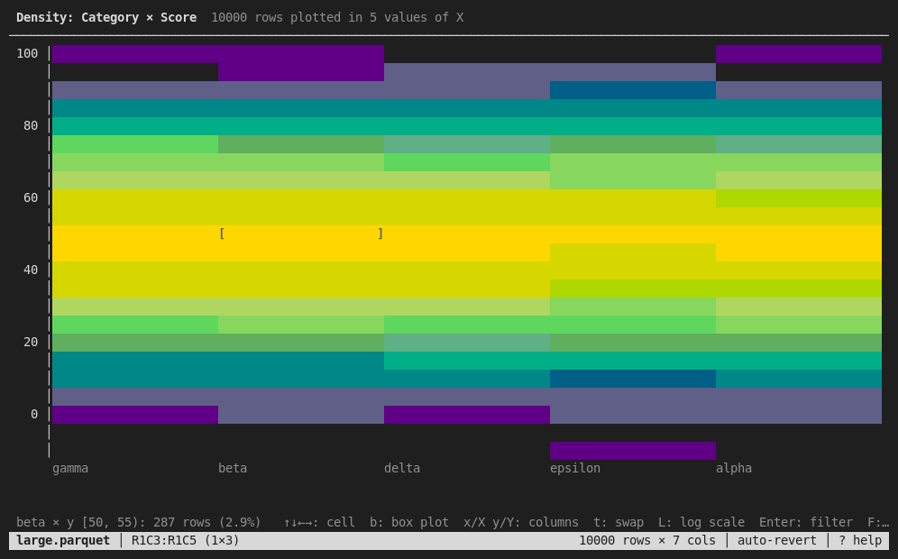

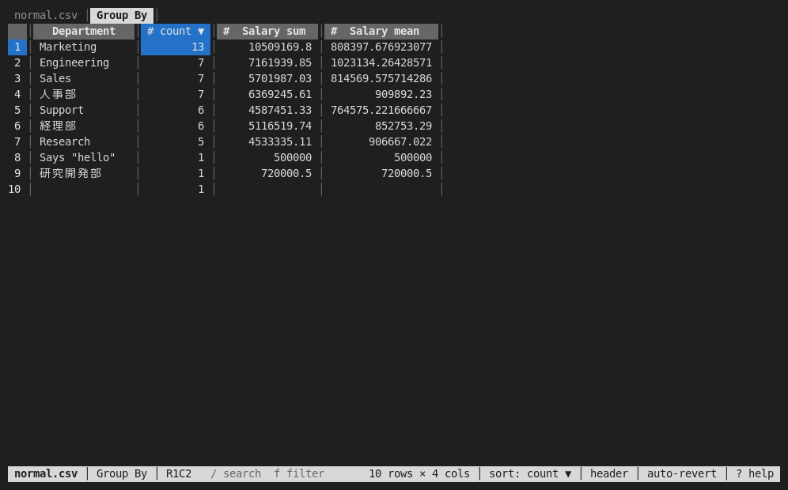

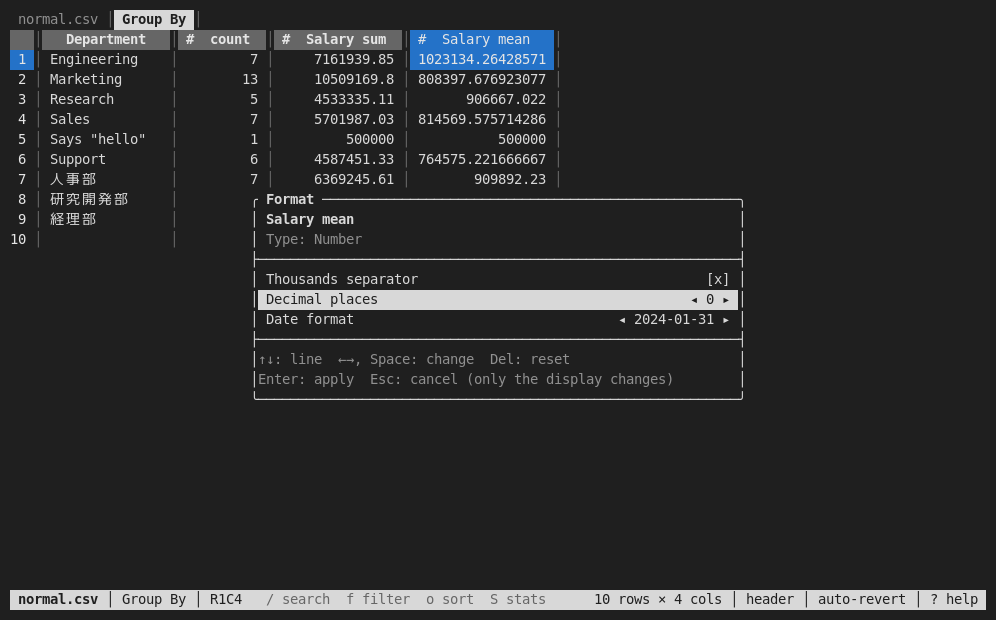

See [Using the Terminal UI](tui.md) for all keys. Saving charts as images
is available in the GUI only.
