# Charts and Group By

[← Contents](README.md)

TableSkim draws charts of the rows you are looking at and summarizes them
in tables, without a spreadsheet or a script. This page shows, with
examples, which tool answers which question, how to read the result, and
how to go from a chart to the rows behind it. The examples use the demo
files in `demo/examples/`: `iris.csv` (150 flowers), `penguins.csv`
(344 penguins), and `hour.csv.xz` (17,379 hourly bike rental records).
See [Example datasets](examples.md) for sources, units and how to open them.

- [Which tool for which question](#which-tool-for-which-question)
- [How one column is distributed: histograms](#how-one-column-is-distributed-histograms)
- [How two columns relate: scatter plots and density](#how-two-columns-relate-scatter-plots-and-density)
- [How groups differ: box plots](#how-groups-differ-box-plots)
- [Summarizing in a table: Group By](#summarizing-in-a-table-group-by)
- [From a chart to the rows](#from-a-chart-to-the-rows)
- [Saving charts as images](#saving-charts-as-images)
- [In the terminal UI](#in-the-terminal-ui)

## Which tool for which question

| Question                                             | Tool                     | GUI                         | TUI |
| ---------------------------------------------------- | ------------------------ | --------------------------- | --- |
| What values does a column hold, and how many of each? | Histogram                | Edit → Histogram...         | `B` |
| Are two number (or date) columns related?            | Scatter plot, density    | Edit → Scatter Plot...      | `M` |
| How does a number differ between groups?             | Box plot                 | Scatter Plot, text on X     | `M` |
| How many rows, and what totals or averages, per group? | Group By               | Edit → Group By...          | `A` |
| Minimum, maximum, mean of one column?                | Column statistics        | Edit → Column Statistics    | `S` |

Every tool works on the **current view**: the rows left by the filter. So
you can filter first (for example to one year) and then chart or group
just those rows; the charts follow when the filter changes.

## How one column is distributed: histograms

A histogram counts how many values fall into each range ("bin") of a
column. Put the current cell in the column and choose **Edit →
Histogram...** (`Ctrl+Shift+H`).

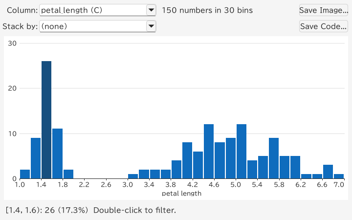

How to read it:

- The **shape** tells how the values are spread. Here the petal lengths form separate
  clusters: the short petals belong to setosa. Choose **Stack by → species**
  to see which species contributes to each bar.
- The **summary** at the top says what was counted: "150 numbers in 30
  bins". All 150 flowers have a petal length; there are no empty values.
- **Point at a bar** for its exact range and count, such as `[1.4, 1.6):
  26 (17.3%)`: 26 flowers have petals at least 1.4 cm and less than 1.6 cm long.

Dates are counted into whole days, months or years; a column of text shows
its most frequent values instead, longest bar first. **Stack by** another
column (`species`, say) splits each bar by that column's values, in a colour
for each, so that you can see what each range is made of. See
[Histograms](gui.md#histograms) for every option and
[How bins are chosen](filtering.md#how-bins-are-chosen) for the details.

## How two columns relate: scatter plots and density

A scatter plot draws one point per row, with one column across (X) and
another up (Y). Choose **Edit → Scatter Plot...** (`Ctrl+Shift+P`). Select
two columns first to plot exactly those (the first one is X); otherwise
TableSkim picks number or date columns near the current cell, and you can
change them in the **X** and **Y** lists.

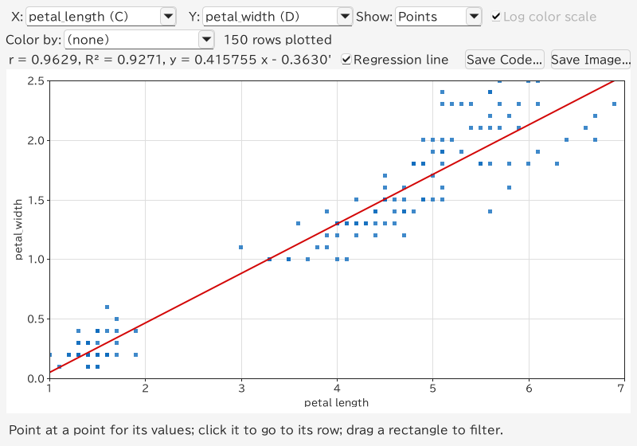

How to read it:

- The line above the plot measures the relation. **r** (Pearson's
  correlation coefficient) runs from −1 to 1: near 1, Y rises with X; near
  −1, Y falls as X rises; near 0, there is no straight-line relation. Here
  `r ≈ 0.9629`: longer petals tend to be wider.
- **R²** is the share of Y's variation that the line explains (about
  92.7% here). The red line is approximately `y = 0.4158 x − 0.3631`,
  with both lengths in cm. This describes an association, not causation.
- **Point at a point** to see its values and row; **click it** to jump to
  that row in the sheet.
- **Color by** a third column (`species`, say) gives each of its values a
  colour, with a legend above the plot, so that you can see whether the
  groups lie apart. Click an entry of the legend to filter to its rows.

The overall Iris correlation also reflects differences between species;
filter to one species to study the relationship within it.

With many rows, points pile up on each other. **Show → Density** counts
the rows in a grid instead, and colours each cell from dark (few rows) to
yellow (many):

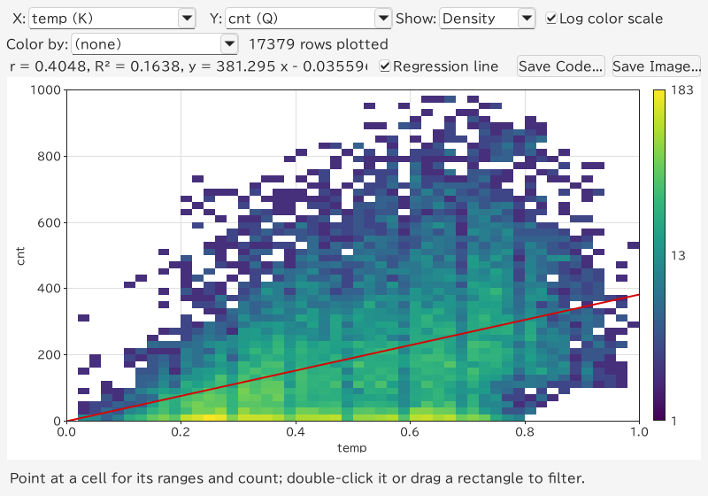

This example uses Bike Sharing: **X → temp**, **Y → cnt**. Temperature is
normalized, not in degrees Celsius; `cnt` counts rentals in an hour.
Demand also changes with hour, season and working day, so temperature alone
does not explain it. **Log color scale** keeps cells with a handful of rows visible next
to the busiest ones; turn it off to compare counts linearly.

## How groups differ: box plots

When X is a column of text, such as `species`, each of its values
becomes a group with a column of its own, and the plot shows a **box plot**
per group. Here: **X → species**, **Y → petal_length** in Iris.

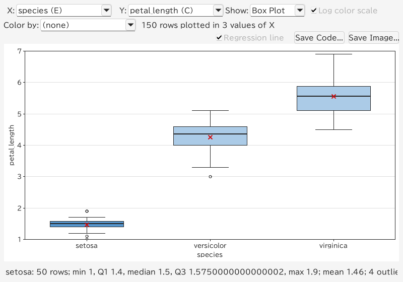

How to read a box:

- The **box** holds the middle half of the group's values: from the first
  quartile (a quarter of the values are below it) to the third (three
  quarters are below it). A tall box means widely spread values.
- The **thick line** in the box is the **median**: half the values are
  below it, half above. The red **×** is the **mean**; when it lies far
  from the median, a few very high or low values pull it.
- The **whiskers** reach the lowest and highest values that are not
  unusual (within 1.5 box heights of the box). **Rings** beyond them are
  **outliers**. These are unusual measurements within a species, not
  necessarily errors.
- **Point at a box** to read its numbers below the plot: count, minimum,
  quartiles, maximum and mean.

Setosa has the shortest petals (median 1.5 cm), versicolor lies between
(median 4.35 cm), and virginica has the longest (median 5.55 cm). Each
species has 50 flowers. Up to 30 groups are shown,
the largest first; the rest are drawn together as **(other)**.

For a group with more than 1,048,576 values, the box statistics are estimated
from a uniform sample of that many values. The displayed row count still
includes the whole group; the sample size and an estimate label appear with
the box's numbers. Minimum, maximum and outlier counts also describe the
sample. Density counts use all rows. The sample is the same whether points
are retained or only the density is calculated.

For another example, open `penguins.csv`, with **X → species**,
**Y → body_mass_g**. Gentoo penguins are generally heavier than Adelie
and Chinstrap. Two rows have no body mass and are skipped; 342 are plotted.

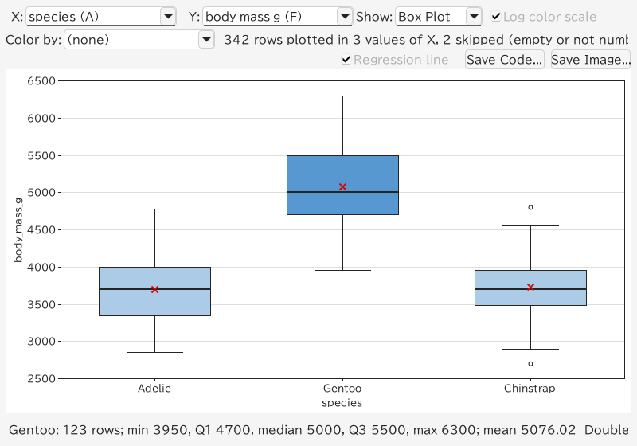

**Show → Density** shows each group's histogram as a column of coloured
cells, which tells more about the shape than a box (two peaks, say):

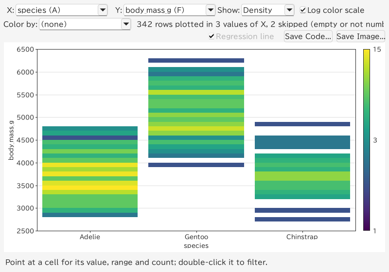

## Summarizing in a table: Group By

Charts show patterns; **Group By** gives the numbers. **Edit → Group
By...** (`Ctrl+Shift+G`) asks which columns to group by and which to
summarize, and puts the result in a new sheet named **Group By**.

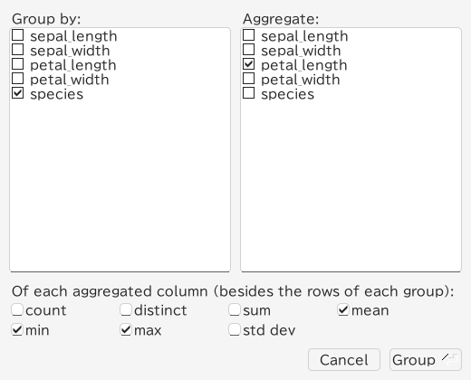

### Counting rows per group

Check only a column to group by and press **Group**: the result has one row
per value with its **count**. Sort the **count** column (click its sort
button twice) to see the largest groups first:

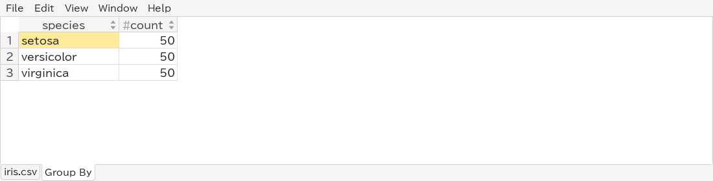

The result has three rows: setosa, versicolor and virginica, each with
`count = 50`. There is no empty species in Iris.

### Means, minimums and maximums per group

Check columns under **Aggregate** and the functions below: **count**
(values that are not empty), **distinct** (different values), **sum**,
**mean**, **min**, **max** and **std dev** (standard deviation). Each
aggregated column and function gives a column such as `petal_length mean`. Means
often have many decimals; **Format** in the column header menu shows them
rounded, for example to three decimal places:

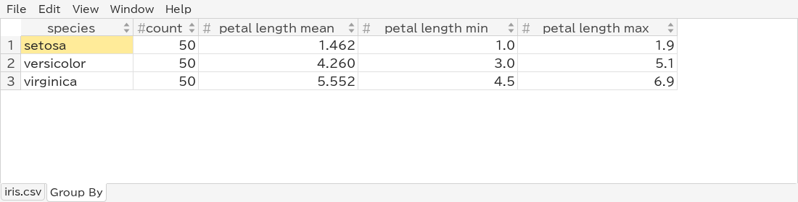

The means are 1.462 cm (setosa), 4.260 cm (versicolor) and 5.552 cm
(virginica). These numbers summarize the differences shown in the boxes.

### Totals of the whole sheet

Leave every **Group by** column unchecked: all rows form one group, and the
result is one row of totals:

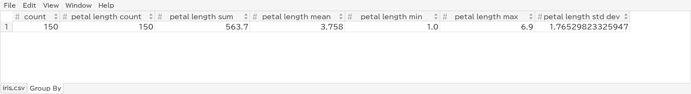

### Grouping by several columns

Check two or more **Group by** columns to count each combination, for
example `species` and `island` in `penguins.csv`: a row for each
species–island combination.

### Working with the result

The **Group By** sheet is an ordinary sheet: sort it, filter it, chart it
(a histogram of `count`, say), copy it, or save it with **File → Export
View...**. Grouping again replaces it. It stays when the file is reloaded,
but it does not change when the original sheet does; group again after
changing the filter. See [Group By](filtering.md#group-by) for how values
are compared.

## From a chart to the rows

Charts and filters work together, so you can drill down step by step:

- **Double-click** a histogram bar, a density cell or a box to filter the
  sheet to its rows; **drag a rectangle** in a scatter plot of numbers to
  filter to the rows inside it.
- The chart is then drawn again for the rows left, so you can narrow down
  further.
- **Edit → Clear Filter** goes back to all rows.

Double-clicking the setosa box above leaves its 50 flowers:

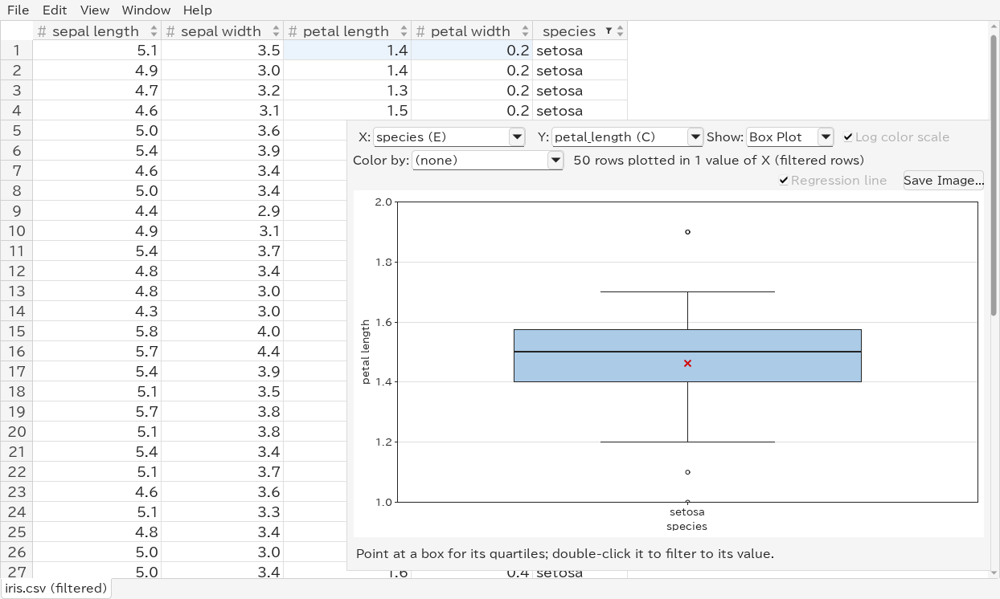

## Saving charts as images

**Save Image...** in the histogram and scatter plot windows writes the
chart as shown, with its axis titles, to a file:

- **PNG** (`.png`): a picture at the size of the window, for slides,
  documents and chat.
- **SVG** (`.svg`): lines and text stay sharp at any size, and the file
  can be edited in a vector drawing program. The points of a scatter plot
  are a picture inside it.

The type follows the extension you type, or the type chosen in the file
dialog. Resize the window first to change the size of the image.

In the [web app](web.md#histograms-and-scatter-plots), **Save PNG** and
**Save SVG** in the chart dialogs do the same; the browser saves the file
into its downloads. The points of a scatter plot are separate shapes in
its SVG.

## In the terminal UI

The terminal UI has the same tools, drawn with characters:

- `B` shows a histogram of the cursor's column; `Enter` filters to a bar,
  and `g` / `G` stack its bars by another column.
- `M` shows the density of two columns (select them first), or box plots
  when X holds text; `b` switches between the box plots and the density,
  `Enter` filters to a box or cell.
- `A` opens the Group By dialog; the result is a sheet, which `o` sorts.
- `%` formats the current column, as **Format** does in the GUI.

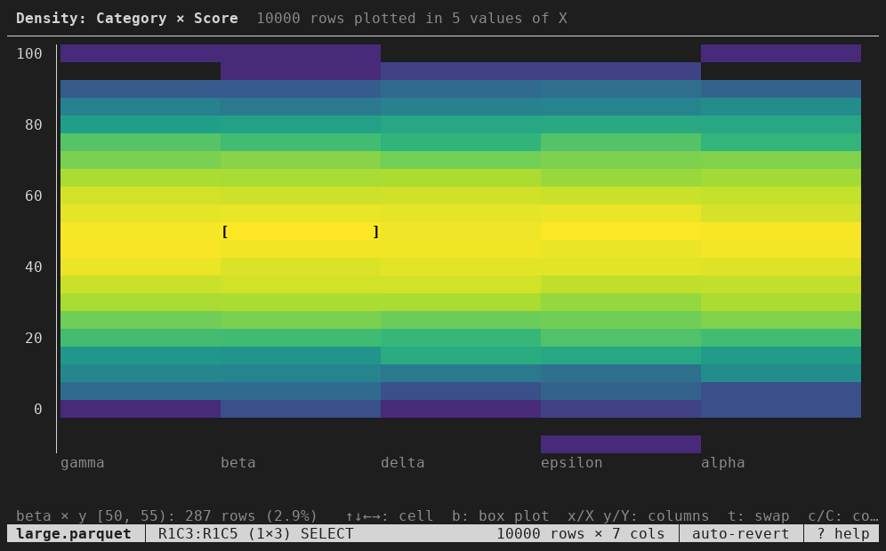

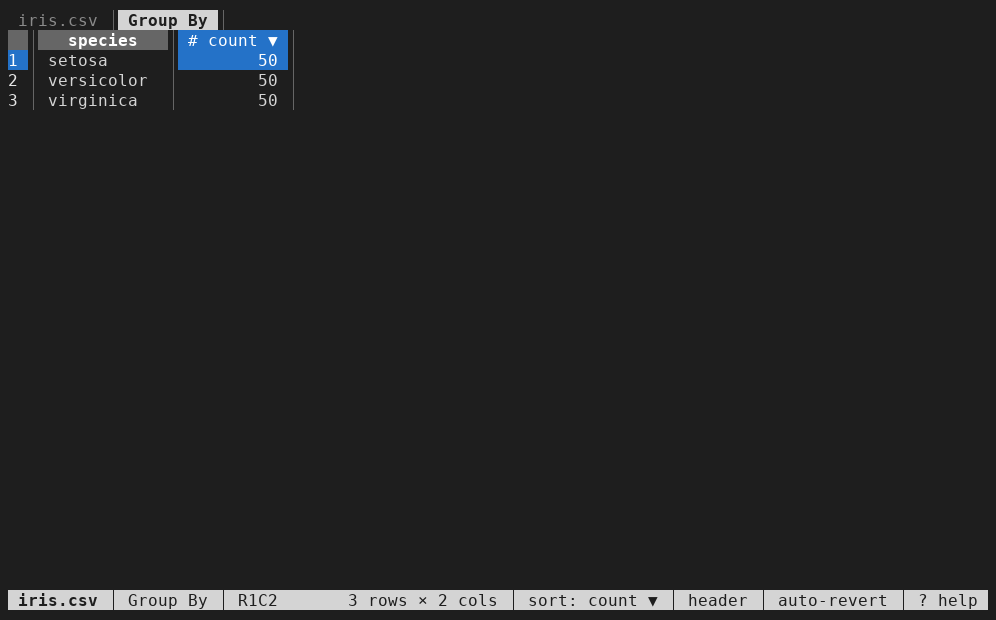

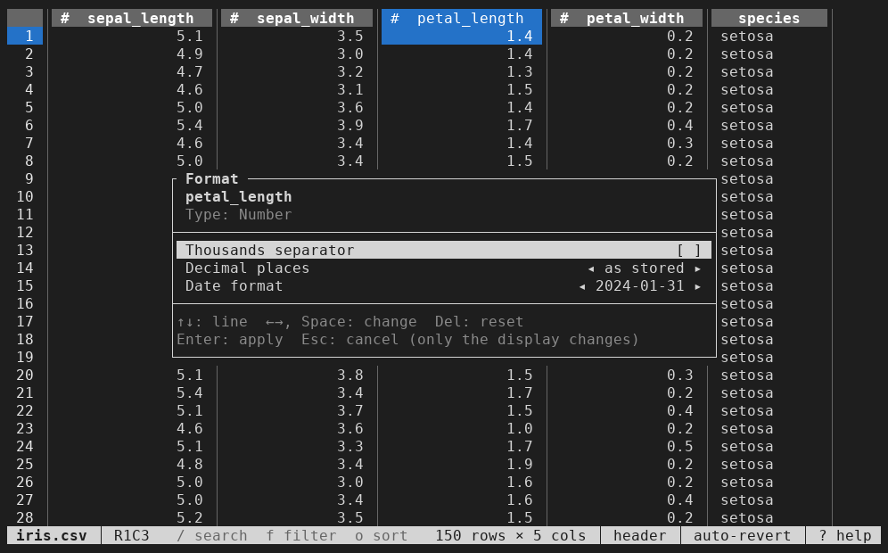

See [Using the Terminal UI](tui.md) for all keys. Saving charts as images
is available in the GUI only.
