# Using the GUI

[← Contents](README.md)

- [The window](#the-window)
- [Opening files](#opening-files)
- [Moving around and selecting](#moving-around-and-selecting)
- [Copying](#copying)
- [Going to a row, cell or column](#going-to-a-row-cell-or-column)
- [The sidebar](#the-sidebar)
- [Sorting](#sorting)
- [Filtering](#filtering)
- [Searching](#searching)
- [Column statistics](#column-statistics)
- [Histograms](#histograms)
- [Scatter plots and 2D density](#scatter-plots-and-2d-density)
- [Group By](#group-by)
- [Hiding and freezing columns](#hiding-and-freezing-columns)
- [Column types and formats](#column-types-and-formats)
- [Sheets](#sheets)
- [Running SQL](#running-sql)
- [Exporting and converting](#exporting-and-converting)
- [Editing cells](#editing-cells)
- [Reloading changed files](#reloading-changed-files)
- [Display options](#display-options)
- [Menu reference](#menu-reference)

On macOS, use `Cmd` wherever this manual says `Ctrl`.

## The window

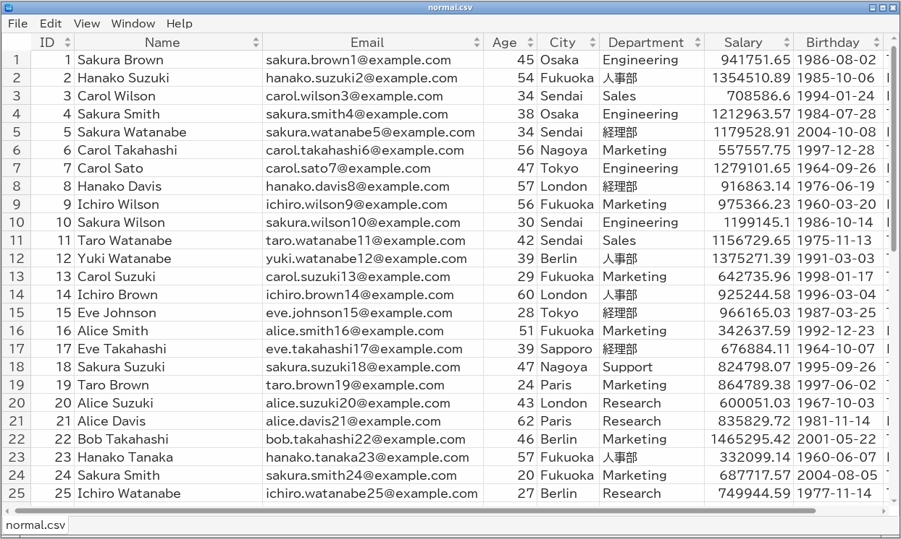

- **Menu bar**: File, Edit, View, Window and Help. On macOS the menus are
  in the system menu bar.
- **Column headers**: the column name, a sort button (the small arrows on
  the right) and, when the column is filtered, a filter mark. A small mark
  on the left tells what the column seems to hold: `#` numbers, `@` dates,
  `?` booleans (see [Column types and formats](#column-types-and-formats)).
- **Row numbers**: the position of the row in the current view (after
  sorting and filtering).
- **Sheet tabs** at the bottom: one tab per sheet. A filtered sheet shows
  `(filtered)` after its name.
- **Sidebar** on the right (hidden at first): the Content, Search, Filter
  and Statistics panes.

Each file opens in its own window. The **Window** menu lists the open
windows so that you can switch between them.

## Opening files

- **File → Open...** (`Ctrl+O`), or the **Open...** button of an empty
  window. The file dialog lists every supported format.
- **File → Open Recent** lists the last ten files opened, newest first, in
  every window. **Clear Recent Files** empties the list. A file that cannot
  be opened any more is taken off it.
- Give files on the command line: `tableskim a.csv b.xlsx`.
- macOS: drop files on the application icon, or use *Open With* in the
  Finder.

A file opened from a window that already shows one opens in a new window.
**File → Close** (`Ctrl+W`) closes the window, **File → Quit** (`Ctrl+Q`)
quits TableSkim.

Rows are read in the background: the table appears at once, cells that are
not loaded yet are filled in as they arrive, and the window stays
responsive.

## Moving around and selecting

- Scroll with the mouse wheel or the scroll bars, or move the current cell
  with the arrow keys, `Page Up` / `Page Down`, `Home` / `End`.
- Click a cell to select it; drag or `Shift`+click to select a range.
- Click a row number to select the row, or a column name to select the
  column.
- Drag the border between two column headers to change the width of a
  column.

## Copying

**Edit → Copy** (`Ctrl+C`) copies the selected cells as tab-separated text
(TSV), which can be pasted into a spreadsheet. Hidden columns are left out.
Tabs and line breaks inside a cell are replaced with spaces, and a cell
that starts with a double quote is quoted so that it pastes back as it
was. If some selected rows are not loaded yet, they are skipped and a
message says how many rows were copied.

## Going to a row, cell or column

**Edit → Go To...** (`Ctrl+G`) jumps to:

- a row number, such as `120`;
- a cell, as `B12` or `R12C2`;
- a column, by its letter (`AB`) or by its name (`Salary`). A column name
  is matched exactly first, then ignoring upper and lower case, and wins
  over a column letter.

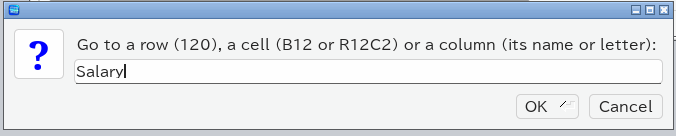

## The sidebar

**View → Show sidebar** shows or hides the sidebar. It also appears
automatically when you use Find, Filter or Column Statistics. Drag its left
edge to make it wider.

The **Content** pane shows the whole value of the selected cell, wrapped to
the width of the pane. This is useful for long text. Double-click a cell to
open it.

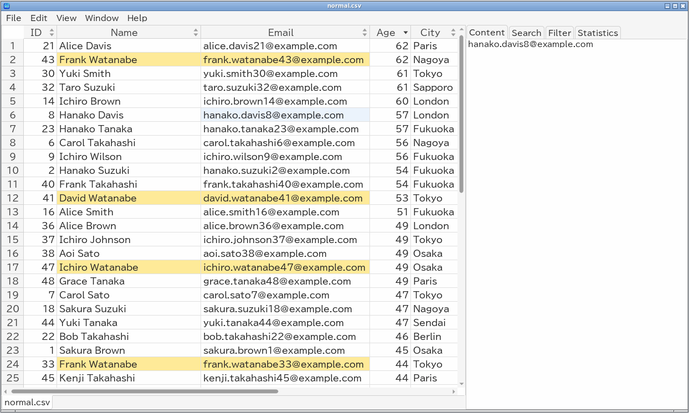

## Sorting

Click the **sort button** (the small arrows at the right of a column header)
to sort by that column: the first click sorts in ascending order, the second
in descending order, and the third restores the file order. The arrow in the
header shows the current direction. Sorting by one column replaces any
other sort.

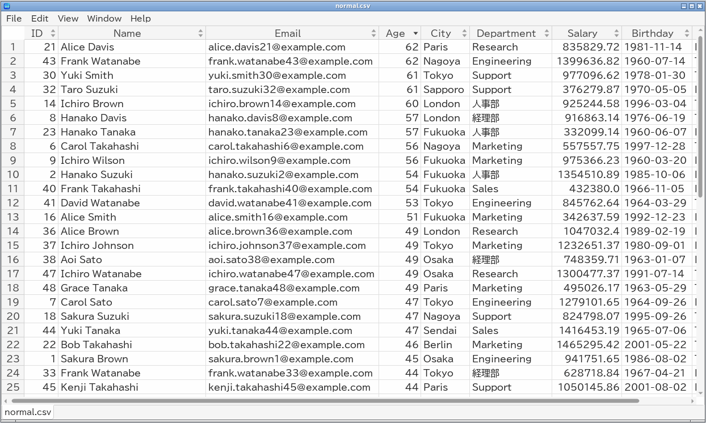

Right-click a column header for the column menu, which has **Sort
Ascending**, **Sort Descending** and **No Sort** as well as filtering,
statistics, histograms, hiding and freezing.

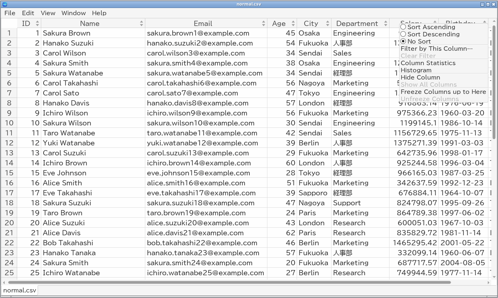

How values are compared (numbers, dates, text, empty cells) is explained in
[Sorting, Filtering, Searching and Statistics](filtering.md).

## Filtering

### Quick filters

Right-click a cell and choose **Filter: = "value"** to show only rows with
the same value in that column, or **Filter: ≠ "value"** to hide them. Each
quick filter is added to the current filter as another condition.

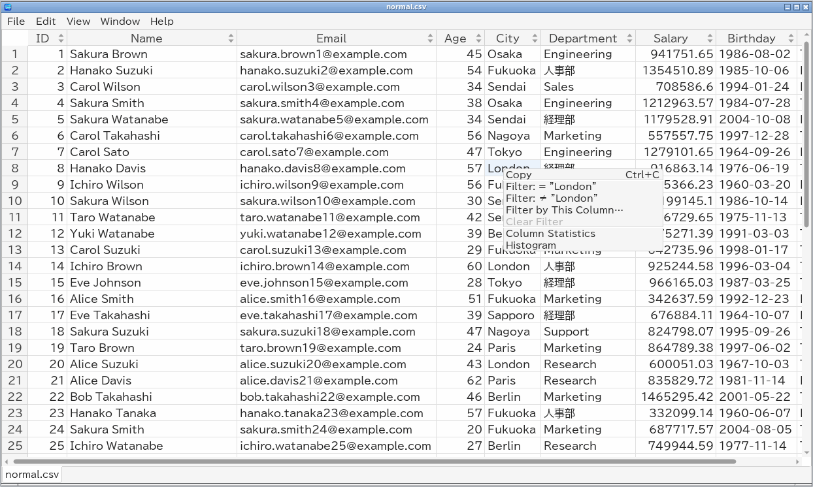

### The Filter pane

**Edit → Filter...** (`Ctrl+Shift+F`), or **Filter by This Column...** in a
column or cell menu, opens the Filter pane.

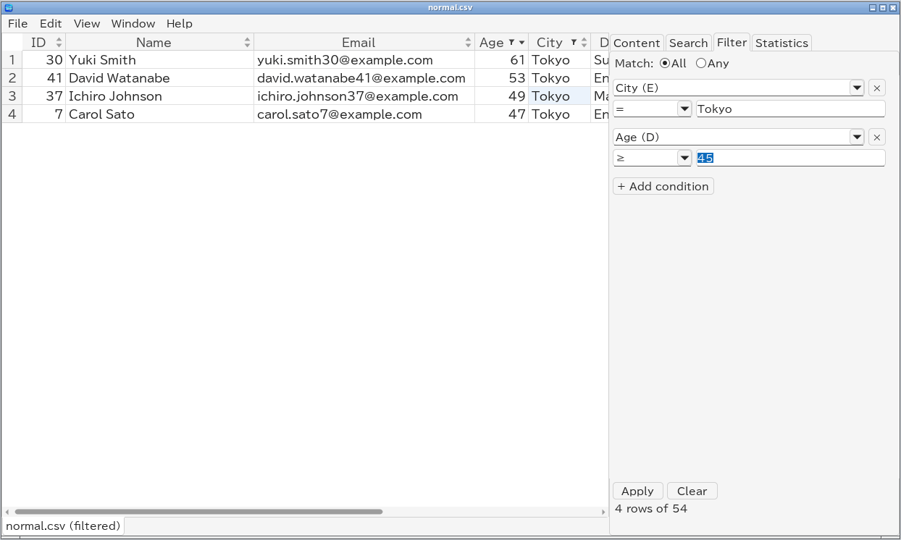

- **Match: All / Any**: show rows that match all conditions (AND) or any
  condition (OR).
- Each condition has a **column**, an **operator** and a **value**. The
  **×** button removes the condition.
- **+ Add condition** adds another condition.
- **Apply** (or `Enter` in a value field) applies the filter. The line
  below shows the result, for example "4 rows of 54".
- **Clear** removes all conditions.

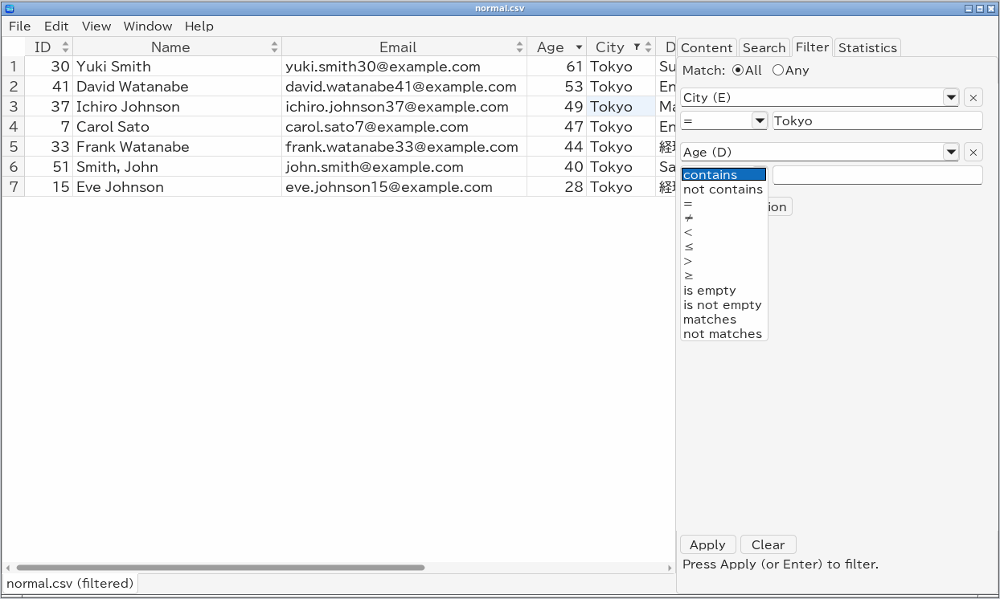

The operators are `contains`, `not contains`, `=`, `≠`, `<`, `≤`, `>`,
`≥`, `is empty`, `is not empty`, `matches` and `not matches` (regular
expressions), `is a number` and `is a date`. Comparisons follow the type of each cell: numbers compare as
numbers, dates as dates, and `= 2024-01-31` matches any time on that day.
See [Sorting, Filtering, Searching and Statistics](filtering.md) for the
details.

**Edit → Clear Filter**, or **Clear Filter** in a column or cell menu,
removes the filter.

## Searching

**Edit → Find...** (`Ctrl+F`) opens the Search pane. Type the text and
press `Enter` or **Search**.

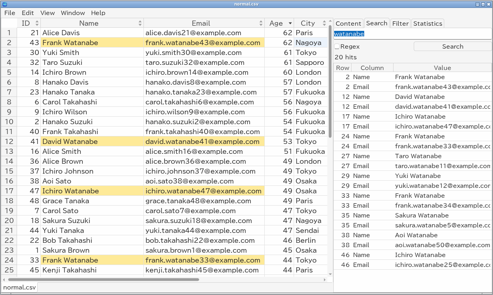

- Matching cells are highlighted in the table, and the list shows the row,
  column and value of every hit. Click a hit to jump to it.
- The search ignores upper and lower case and finds the text anywhere in a
  cell.
- Check **Regex** to search with a regular expression (RE2 syntax).
- The search runs in the background; the status line shows the progress
  and the number of hits.

## Column statistics

**Edit → Column Statistics** (`Ctrl+Shift+I`), or **Column Statistics** in
a column or cell menu, opens the Statistics pane for the current column.
Choose another column from the list at the top.

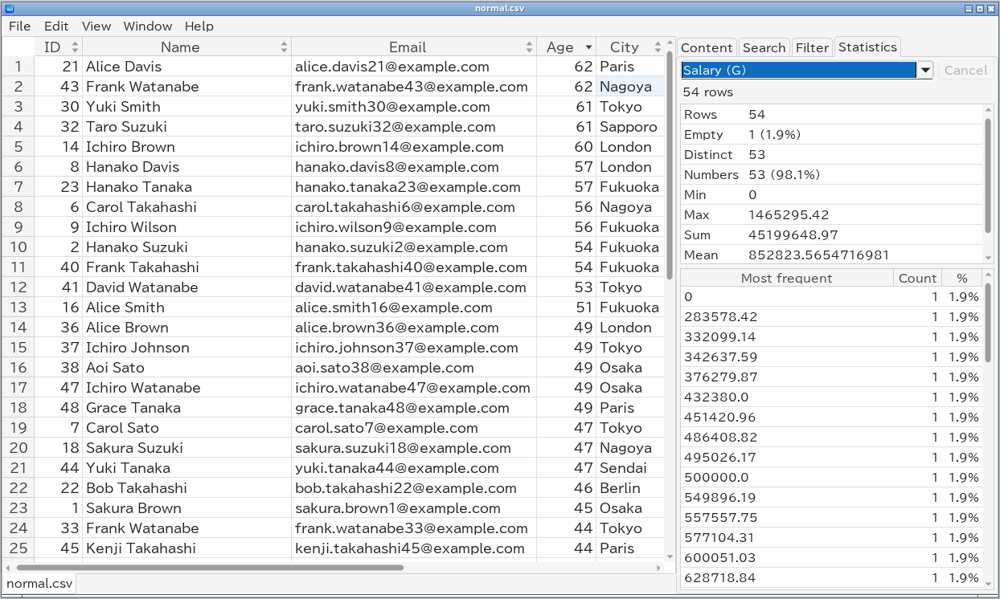

- The summary shows the number of **rows**, **empty** cells, **distinct**
  values and, for numeric columns, **numbers**, **min**, **max**, **sum**,
  **mean** and **standard deviation**.
- The table below lists the **most frequent** values with their counts and
  percentages.
- Statistics cover the rows of the current view, so they follow the filter.
- **Double-click** a value to filter by it. **Right-click** a value for
  **Filter: =**, **Filter: ≠** and **Copy Value**.
- Drag the border between the summary and the list to resize them.
- **Cancel** stops a computation that takes long on a large file.

## Histograms

[Charts and Group By](charts.md) shows, with examples, which chart to use
and how to read it.

**Edit → Histogram...** (`Ctrl+Shift+H`), or **Histogram** in a column or
cell menu, opens a histogram of the current column in a window of its own.
Choose another column from the **Column** list at the top; the line next to
it summarizes what was counted, for example "53 numbers in 30 bins, 1
empty".

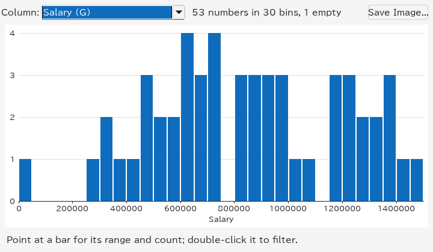

- **Numbers** are counted into about 30 bins of round widths, such as
  50000 or 0.2. Integer columns whose values span at most about 30
  numbers (such as ages 20 to 45) get one bar per value.
- **Dates and date-times** are counted into bins of whole days, weeks,
  months, years and so on, depending on the range of the column.
- **Other columns** (text) show their most frequent values as horizontal
  bars instead.
- **Point at a bar** to see its range and count below the chart, for
  example `[600000, 650000): 4 (7.5%)`. A range includes its lower bound
  and excludes its upper bound (`[` and `)`), except the last bar of
  numbers, which includes both (`[1450000, 1500000]`).
- **Double-click a bar** to filter the sheet to the rows of that bar. The
  histogram is then recomputed for the remaining rows, so you can drill
  down step by step. **Edit → Clear Filter** goes back to all rows.

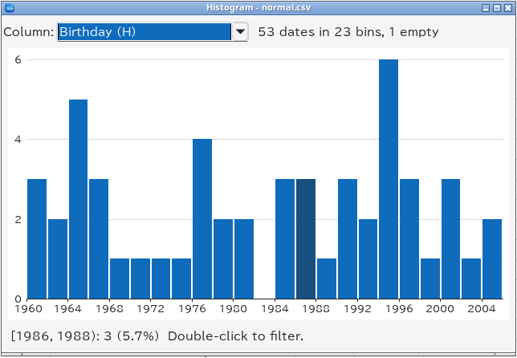

The histogram always follows the current view of the sheet: changing the
filter, in the Filter pane or anywhere else, recomputes it, and the summary
says "(filtered rows)". Below, the 1994–1995 bar was double-clicked: the
sheet now shows those six rows and the histogram shows them in monthly bins.

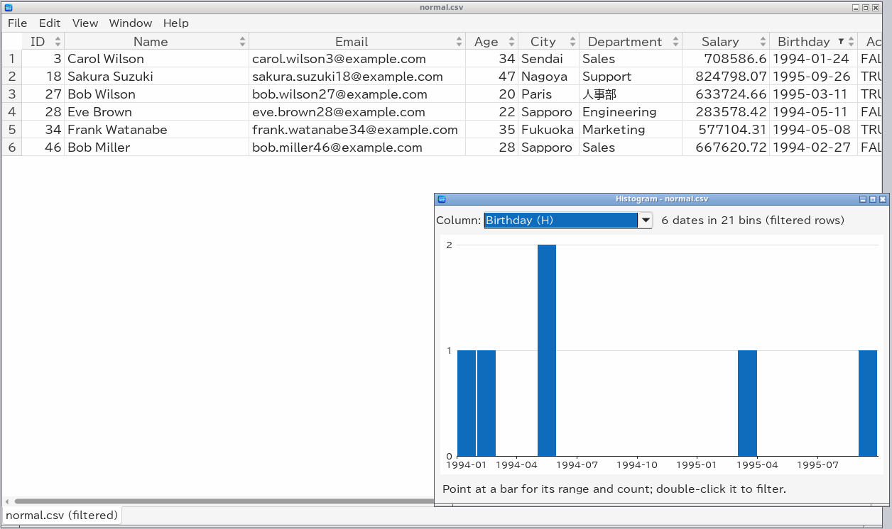

For a text column, each bar is one value; double-clicking it filters the
sheet to that value.

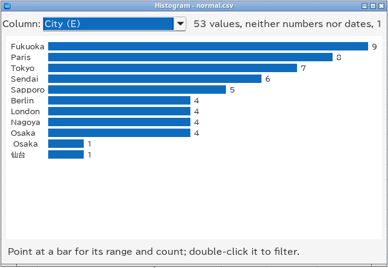

How bins are chosen is described in [Sorting, Filtering, Searching and
Statistics](filtering.md#histograms).

**Save Image...** writes the chart as a PNG or SVG file (by the extension
of the name, or the type chosen in the dialog). The image is the chart as
shown, at its size in the window, with the column name under the axis.

## Scatter plots and 2D density

**Edit → Scatter Plot...** (`Ctrl+Shift+P`), or **Scatter Plot** in a
column or cell menu, plots two columns against each other in a window of
its own. If two or more columns are selected, the first and last are X and
Y. Otherwise TableSkim picks columns holding numbers or dates (judged by
the rows around the current cell): Y is the current column, or the nearest
such column, and X the nearest such column to its left (or, if there is
none, to its right). Choose other columns from the **X** and **Y** lists,
and the kind of plot from **Show**:

- **Points** draws a point per row. Many points on top of each other look
  darker, so dense areas stand out. A large table is plotted as a random
  sample of 200,000 rows (the summary says so); the sample is the same
  each time.
- **Density** divides the plot into a grid of about 50 × 50 cells and
  colours each cell by the number of rows in it, from dark purple (few) to
  yellow (many), with the scale on the right. **Log color scale** (on by
  default) keeps cells with a few rows visible next to very dense ones.
  Empty cells stay blank. The density always counts every row.

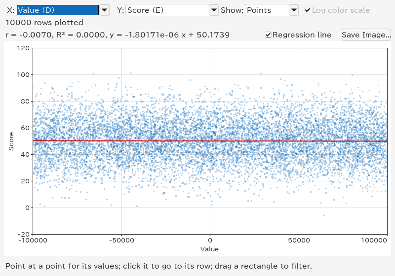

Y must hold numbers or dates. X may hold numbers or dates too, or text
(see [Text on X: box plots](#text-on-x-box-plots) below). Rows where either
value is empty or of another kind are left out and counted as "skipped"
in the summary.

The line under the summary shows how closely the columns are related, for
example `r = 0.0945, R² = 0.0089, y = 2641.23 x + 744351`: Pearson's
correlation coefficient *r* (from −1 to 1), its square *R²*, and the
least-squares line. They are computed over every row plotted, not only the
sample of points. **Regression line** draws that line on the plot. The
equation is left out when a column holds dates, whose values would be in
microseconds.

- **Point at a point** to see its values and row number below the plot;
  **click it** to move the current cell of the sheet to that row.
- **Point at a cell** of the density to see its ranges and count, for
  example `x [-30000, -25000) × y [60, 65): 22 rows (0.2%)`;
  **double-click it** to filter the sheet to the rows of that cell.
- **Drag a rectangle** (in either view) to filter the sheet to the rows
  whose X and Y values lie inside it.

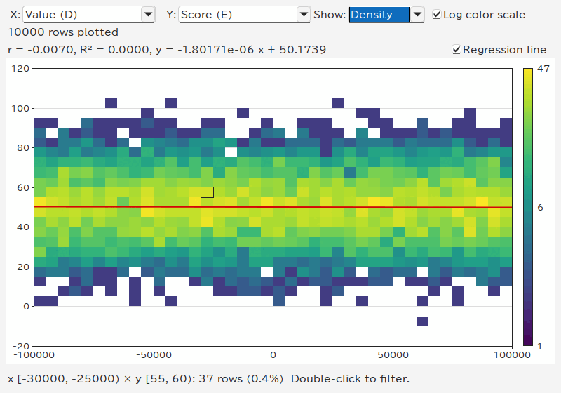

Like the histogram, the plot follows the current view of the sheet, so
after filtering it is drawn again for the rows left. **Edit → Clear
Filter** goes back to all rows. See [Sorting, Filtering, Searching and
Statistics](filtering.md#scatter-plots-and-2d-density) for the details.

### Text on X: box plots

When the X column holds text (such as a city or a department), each of its
values is a category with a column of its own: the 30 most frequent values,
most frequent first, and **(other)** for the rest. **Show** then switches to
**Box Plot** (it is available only then):

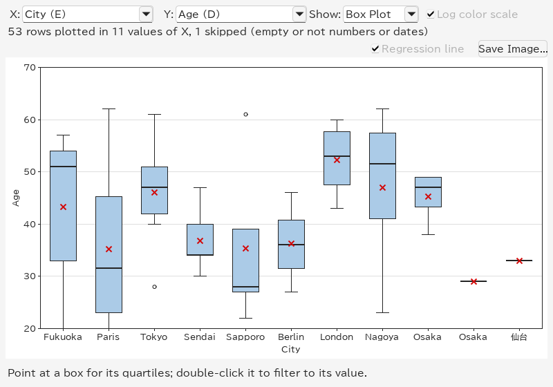

- Each **box** spans the first to the third quartile of the category's Y
  values, with the **median** as a thick line and the **mean** as a red
  cross. The **whiskers** reach the furthest values within 1.5 times the
  box's height from it; values beyond them are drawn as small rings.
- **Point at a box** to see the category's count, minimum, quartiles,
  maximum, mean and number of outliers below the plot; **double-click it**
  to filter the sheet to that category.
- **Density** shows a histogram of Y for each category, side by side, as
  coloured cells: double-click a cell to filter to that category and range.
- **Points** spreads each category's points sideways over its column, so
  that they do not hide each other.

There is no correlation or regression line for categories, and no
rectangle to drag.

### Saving the plot

**Save Image...** writes the plot as a PNG or SVG file, as shown: the kind
of plot, the colour scale, the regression line and the axis titles (the
column names). The type follows the extension of the name (`.png` or
`.svg`), or the type chosen in the file dialog. SVG files keep lines and
text sharp at any size; the points of a scatter plot are an image inside
them.

## Group By

See also [Charts and Group By](charts.md#summarizing-in-a-table-group-by)
for worked examples.

**Edit → Group By...** (`Ctrl+Shift+G`), or **Group By…** in a column
menu, counts the rows of the current sheet by the values of some columns,
like a pivot table or SQL's `GROUP BY`, and shows the result in a new
sheet named **Group By**.

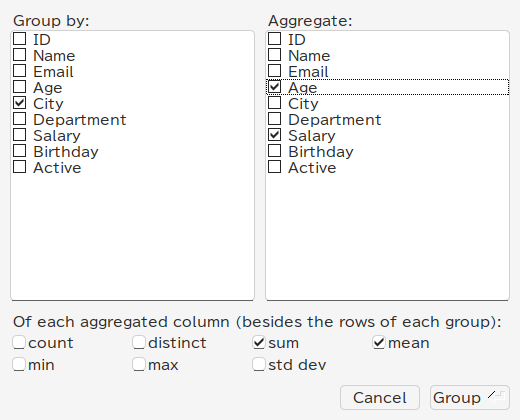

- **Group by**: rows with equal values in these columns form a group. The
  selected columns (or the clicked one) are checked at first. With none,
  every row is in one group, which gives totals.
- **Aggregate**: columns to summarize in each group, with the functions
  checked below: **count** (non-empty values), **distinct** (distinct
  values), **sum**, **mean**, **min**, **max** and **std dev** (sample
  standard deviation).

The result has one row per group, in sort order of the group's values: the
group columns, **count** (the rows of the group), and a column such as
`Salary sum` for each aggregated column and function. It covers the rows of
the current view, so it follows the filter.

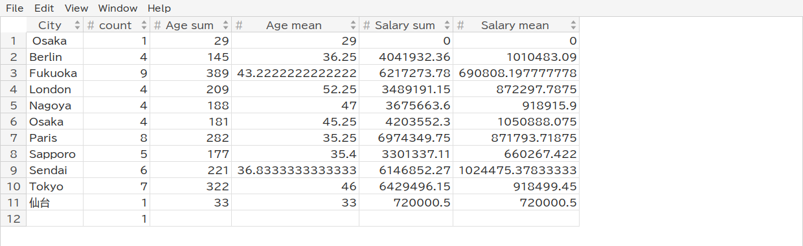

The **Group By** sheet can be sorted, filtered, exported and grouped again
like any other. Grouping again replaces it. It is a snapshot: it does not
change when the original sheet does, but stays when the file is reloaded.
Empty cells form a group of their own; how values are compared is described
in [Sorting, Filtering, Searching and Statistics](filtering.md#group-by).

## Hiding and freezing columns

### Hiding columns

Right-click a column header and choose **Hide Column**. If several columns
are selected and you right-click one of them, **Hide Columns** hides them
all. **View → Show All Columns** (or **Show All Columns** in the column
menu) shows them again.

Hidden columns are skipped when moving the cursor, copying and exporting.
They still take part in sorting, filtering and statistics.

### Freezing columns

Right-click a column header and choose **Freeze Columns up to Here**: that
column and all columns to its left stay in place when you scroll sideways.
**Unfreeze Columns** in the column menu, or **View → Freeze Columns**,
turns it off. At least one column must remain unfrozen.

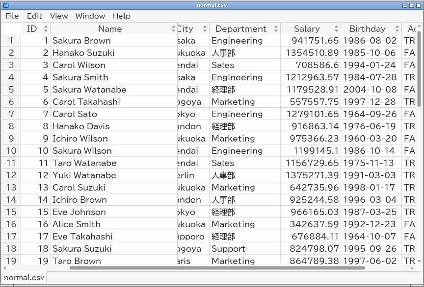

## Column types and formats

TableSkim looks at the first 1,000 rows read to tell what each column
holds, and marks the header: `#` for numbers, `@` for dates and date-times,
`?` for booleans (TRUE / FALSE). Text and mixed columns have no mark. Text
cells count as what they read as, so a CSV column of `42` and `3.5` is a
number column. A few stray values (a `-` among numbers) do not change the
kind, as long as 90% of the values agree.

**Format** in the column header menu changes how the column shows its
values; the first line of the submenu shows its type, for example
"Type: Number (whole numbers)":

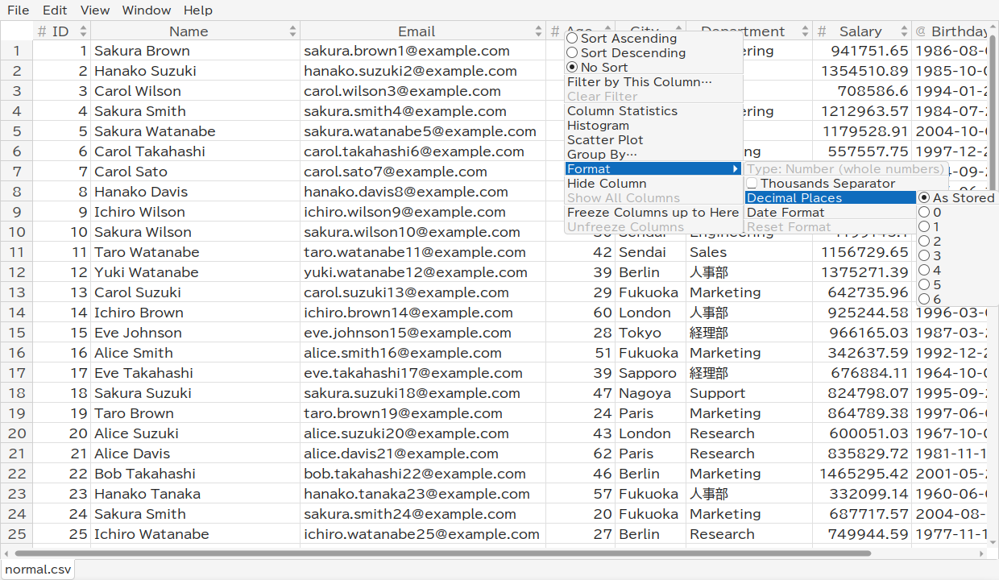

- **Thousands Separator**: `1234567.5` is shown as `1,234,567.5`.
- **Decimal Places**: **As Stored**, or 0 to 6 places, rounded
  (`1234.5678` with 2 places is `1234.57`).
- **Date Format**: `2024-01-31`, `2024/01/31`, `01/31/2024`, `31/01/2024`,
  `2024年1月31日` or `Jan 31, 2024`. A time of day stays as it is.
- **Reset Format** goes back to the values as stored.

If several columns are selected and you right-click one of them, the
change applies to all of them. Numbers and dates held as text are formatted
too. Only the display changes: sorting, filtering, copying and exporting
use the values as they are. Formats belong to the sheet in this window and
are kept when the file is reloaded.

## Sheets

Excel workbooks and databases show one tab per worksheet, table or view at
the bottom of the window. Click a tab to switch. Each sheet keeps its own
sort, filter, hidden and frozen columns.

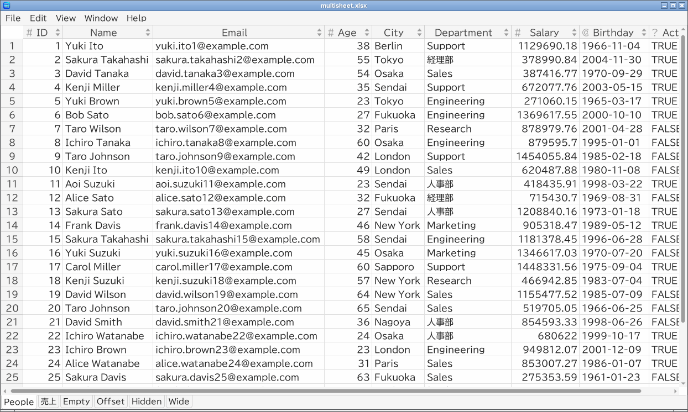

## Running SQL

For DuckDB, SQLite, Parquet and JSON files, **Edit → Run SQL...**
(`Ctrl+E`) opens the SQL window. Type a query and press **Run**
(`Ctrl+Enter`); the result appears as a new sheet named **SQL Result**.

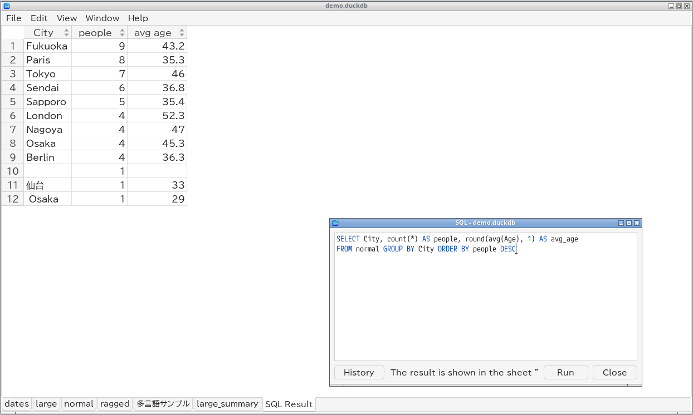

The SQL window has a history (**History**, `Ctrl+Up` / `Ctrl+Down`) and
completion (`Tab`). See [Running SQL](sql.md) for details.

## Exporting and converting

- **File → Export View...** (`Ctrl+Shift+E`) saves the current sheet as
  shown (sorted, filtered, without hidden columns) to CSV, TSV, Excel or
  Parquet.
- **File → Convert to Parquet / DuckDB...** converts a text file (CSV, TSV,
  VCF) to Parquet or a DuckDB database, for fast access later.

Both run behind a progress dialog with a **Cancel** button. See [Exporting
and Converting](exporting.md).

## Editing cells

Cells of CSV / TSV and Excel files can be changed in edit mode only:
**Edit → Edit Mode** (`Ctrl+Shift+M`) turns it on and off, and the title
shows `[Editing]`. Then `F2`, `Enter`, typing or a double click edits a
cell, `Delete` clears the selected cells, **Edit → Paste** (`Ctrl+V`)
pastes tab-separated text, **Edit → Undo** / **Redo** take changes back,
and **File → Save** (`Ctrl+S`) or **File → Save As...** (`Ctrl+Shift+S`)
writes them. Edited cells are green until saved. See [Editing
Cells](editing.md).

## Reloading changed files

- **File → Revert** reloads the file from disk.
- **File → Auto Revert** (on by default) checks the file regularly (every
  second while the window is active, every five seconds otherwise) and
  reloads it when it has changed. This is handy for watching a file that
  another program writes.
- **File → Follow End of File** (`Ctrl+Shift+T`) keeps showing the end of
  a file that grows, like `tail -f`: the file is checked twice a second
  (whether or not Auto Revert is on), and the current cell moves to the
  last row whenever rows are added. For CSV / TSV files that are not
  compressed (in UTF-8 or Shift_JIS), only the appended lines are read, so
  even a large log file keeps up; a line being written is shown once it
  ends. Other files, and files that were rewritten rather than appended to,
  are reloaded. A sorted or filtered sheet sorts and filters the new rows
  too. Choose the item again to stop following.
- **File → Show File in File Browser** opens the folder of the file in the
  system file manager.

After a reload, a SQL result sheet is computed again by running the last
query. With unsaved edits, Revert asks before dropping them, and Auto
Revert waits (the title shows `(changed on disk)` if the file changes).

## Display options

The **View** menu:

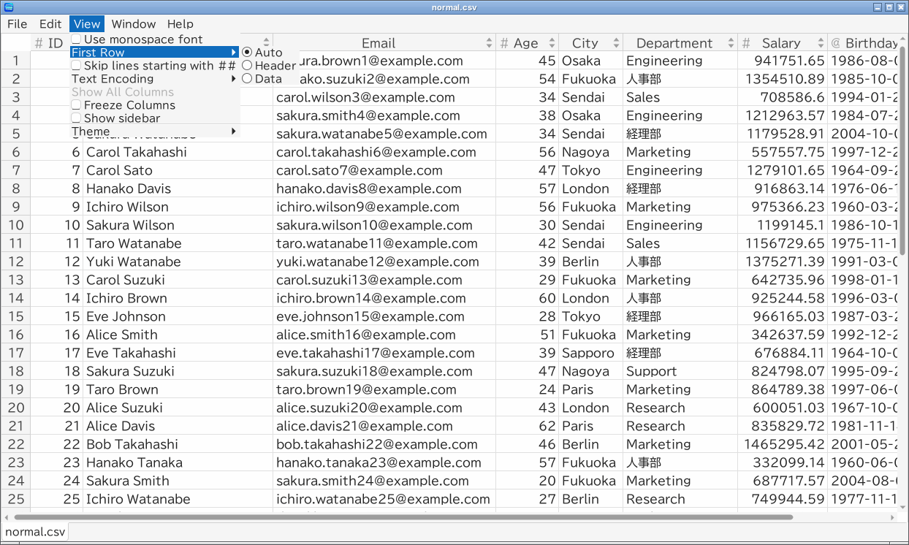

| Item                              | Effect                                                         |
| --------------------------------- | -------------------------------------------------------------- |
| Use monospace font                | Show cells in a monospace font                                 |
| Use first row as header           | Take column names from the first row (CSV / TSV / Excel)       |
| Skip lines starting with ##       | Drop `##` lines of text files (on by default for VCF)          |
| Text Encoding                     | UTF-8, UTF-16LE, UTF-16BE or Shift_JIS (CP932), for CSV / TSV  |
| Show All Columns                  | Show hidden columns again                                      |
| Freeze Columns                    | Freeze the columns up to the selected one, or unfreeze them    |
| Show sidebar                      | Show or hide the sidebar                                       |
| Theme                             | Fluent, Basic, Plastic, GTK+, Gleam or Oxy look                |

Items that do not apply to the current file (for example the header option
for a Parquet file) are disabled.

## Menu reference

| File menu                          | Shortcut       |
| ---------------------------------- | -------------- |
| Open...                            | `Ctrl+O`       |
| Open Recent                        |                |
| Close                              | `Ctrl+W`       |
| Save (edit mode)                   | `Ctrl+S`       |
| Save As... (edit mode)             | `Ctrl+Shift+S` |
| Revert                             |                |
| Auto Revert                        |                |
| Follow End of File                 | `Ctrl+Shift+T` |
| Export View...                     | `Ctrl+Shift+E` |
| Convert to Parquet / DuckDB...     |                |
| Show File in File Browser          |                |
| Quit (in the application menu on macOS) | `Ctrl+Q`  |

| Edit menu                          | Shortcut       |
| ---------------------------------- | -------------- |
| Undo (edit mode)                   | `Ctrl+Z`       |
| Redo (edit mode)                   | `Ctrl+Shift+Z` |
| Copy                               | `Ctrl+C`       |
| Paste (edit mode)                  | `Ctrl+V`       |
| Find...                            | `Ctrl+F`       |
| Go To...                           | `Ctrl+G`       |
| Filter...                          | `Ctrl+Shift+F` |
| Clear Filter                       |                |
| Column Statistics                  | `Ctrl+Shift+I` |
| Histogram...                       | `Ctrl+Shift+H` |
| Scatter Plot...                    | `Ctrl+Shift+P` |
| Group By...                        | `Ctrl+Shift+G` |
| Run SQL...                         | `Ctrl+E`       |
| Edit Mode                          | `Ctrl+Shift+M` |

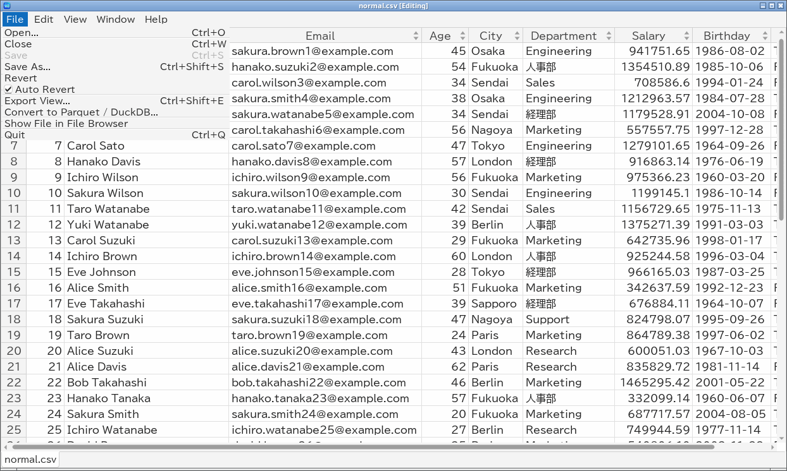
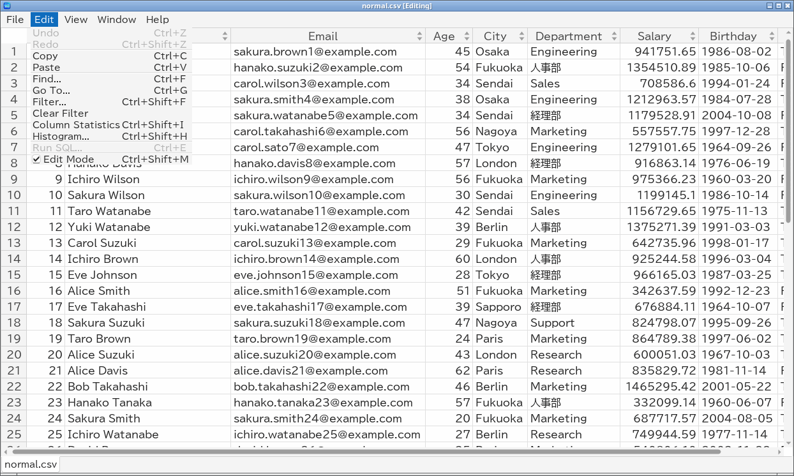

| Help menu                          | Shortcut       |
| ---------------------------------- | -------------- |
| User Manual                        | `F1`           |
| About...                           |                |

**Help → User Manual** (`F1`) opens this manual in a window of its own, in
Japanese if that is the language of the system and in English otherwise;
the list at the top right switches the language. **Back** / **Forward**
(`Alt+Left` / `Alt+Right`) return to pages seen before, and **Contents**
goes to the table of contents. The manual is built into TableSkim, so it
works offline.

**Help → About...** shows the version and the licenses of the bundled
third-party software and fonts.
