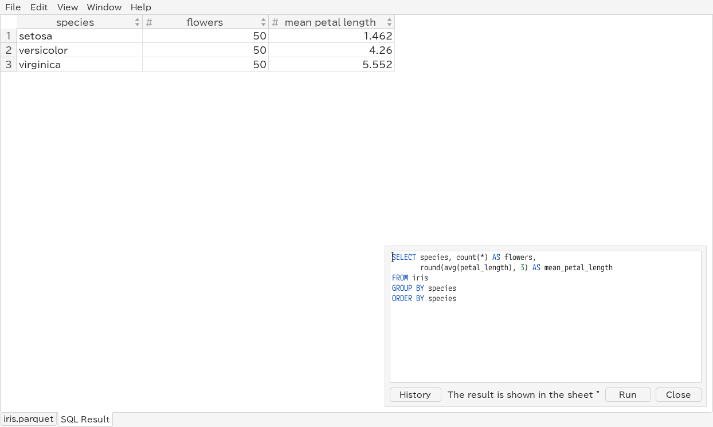

# Running SQL

[← Contents](README.md)

TableSkim can run SQL on **DuckDB**, **SQLite**, **Parquet** and **JSON**
files. A query result is shown as an extra sheet named **SQL Result**,
which you can sort, filter, search, summarize and export like any other
sheet.

- GUI: **Edit → Run SQL...** (`Ctrl+E`) opens the SQL window.
- Terminal UI: `:` opens the SQL prompt at the bottom of the screen.
- Web app: the **SQL** button opens the SQL panel at the bottom of the
  page (see [Running SQL](web.md#running-sql)).



## What you can query

| File            | SQL dialect | Tables you can use                                      |
| --------------- | ----------- | ------------------------------------------------------- |
| DuckDB database | DuckDB      | Every table and view of the database                    |
| SQLite database | SQLite      | Every table and view of the database                    |
| Parquet file    | DuckDB      | The file, by its name without the extension (`sales.parquet` → `sales`) |
| JSON file       | DuckDB      | The file, by its name without the extensions (`events.jsonl.gz` → `events`) |

Names that contain spaces, symbols or non-ASCII characters can be quoted
with double quotes, for example `SELECT * FROM "多言語サンプル"`.

## Running a query

Type the SQL and press **Run** (`Ctrl+Enter`) in the GUI, or `Enter` in the
terminal UI.

For this example, convert `demo/examples/iris.csv` with **File → Convert to Parquet / DuckDB...** (`P` in the TUI), then open `iris.parquet`. SQL is unavailable on the original CSV. The result has three species, each with 50 flowers and mean petal lengths of 1.462, 4.260 and 5.552 cm.

```sql
SELECT species, count(*) AS flowers,
       round(avg(petal_length), 3) AS mean_petal_length
FROM iris
GROUP BY species
ORDER BY species
```

- A single query (`SELECT`, `WITH`, `VALUES`, ...) is shown in the **SQL
  Result** sheet, which the window switches to. Running another query
  replaces it.
- Other statements are run and a message reports the outcome, for example
  "Done". If several statements return rows, only a single query is shown
  as a sheet.
- Errors are shown in a message box.
- After the file is reloaded (Revert or Auto Revert), the last query is run
  again so that the SQL Result sheet stays up to date.

## Files are read-only

Files are opened read-only: SQL cannot change the database or the file.
SQL allows queries and temporary table/view operations. You can create,
update and drop temporary tables and views, which disappear when the
window is closed:

```sql
CREATE TEMP TABLE setosa AS SELECT * FROM iris WHERE species = 'setosa';
```

Writing external files (`COPY ... TO`, `EXPORT`, `VACUUM INTO`), attaching
other databases, loading extensions and changing engine settings through
SQL are blocked. To save a query result, use **Export View...** (`w` in
the terminal UI).

## History

Every query you run is saved in a history that is shared by all windows
and by later sessions.

- GUI: the **History** button lists earlier queries; `Ctrl+Up` /
  `Ctrl+Down` in the editor step through them.
- Terminal UI: `Up` / `Down` in the SQL prompt.

The history is stored in a file named `sql_history`:

| Platform | Location                                                       |
| -------- | -------------------------------------------------------------- |
| Linux    | `$XDG_STATE_HOME/tableskim/` (usually `~/.local/state/tableskim/`) |
| macOS    | `~/Library/Application Support/TableSkim/`                     |
| Windows  | `%APPDATA%\TableSkim\`                                          |

The Microsoft Store version keeps it in its own folder,
`%LOCALAPPDATA%\Packages\<package name>\LocalCache\Roaming\TableSkim\`,
which Windows removes when the app is uninstalled.

## Completion

Press `Tab` to complete the word before the cursor: table and view names,
column names, and SQL keywords. After `name.` it offers the columns of that
table, and it knows aliases given in `FROM` and `JOIN`, so
`SELECT i.` completes the columns of `iris` in
`SELECT i. FROM iris AS i`.

## Tips

- Sorting and filtering in the SQL Result sheet work like in other sheets,
  so a simple `SELECT * FROM table WHERE ...` is often enough; refine the
  result with the Filter pane.
- To query a large CSV file with SQL, convert it to Parquet or DuckDB
  first (**File → Convert to Parquet / DuckDB...**, `P` / `D` in the
  terminal UI), then open the converted file.
