# Using the Terminal UI

[← Contents](README.md)

The terminal UI (TUI) runs in a terminal, so you can browse tables on a
remote server over SSH. It offers the same features as the GUI, including
histograms; of the scatter plot, it shows the 2D density.

- [Starting](#starting)
- [The screen](#the-screen)
- [Moving and selecting](#moving-and-selecting)
- [The sidebar: cell contents and statistics](#the-sidebar-cell-contents-and-statistics)
- [Histograms](#histograms)
- [2D density](#2d-density)
- [Group By](#group-by)
- [Sorting](#sorting)
- [Filtering](#filtering)
- [Searching](#searching)
- [Going to a row, cell or column](#going-to-a-row-cell-or-column)
- [Hiding and freezing columns](#hiding-and-freezing-columns)
- [Column types and formats](#column-types-and-formats)
- [Copying](#copying)
- [Sheets](#sheets)
- [Running SQL](#running-sql)
- [Exporting and converting](#exporting-and-converting)
- [Following a growing file](#following-a-growing-file)
- [Other settings](#other-settings)
- [Key reference](#key-reference)

## Starting

```sh
tableskim data.csv        # without a graphical display
tableskim -t data.csv     # force the terminal UI
tableskim-tui.exe data.csv   # Windows
```

The terminal UI starts automatically when there is no graphical display
(see [Getting Started](getting-started.md#starting-tableskim)). It shows
exactly one file, given on the command line. Press `q` (or `Ctrl+C`) to
quit.

## The screen

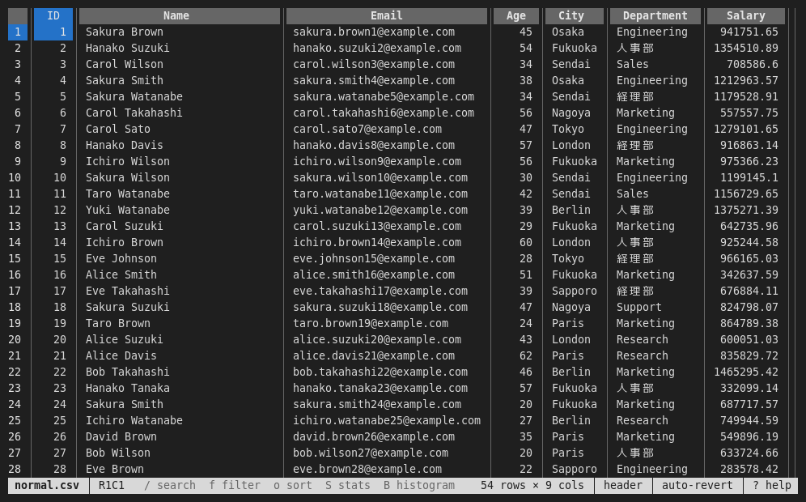

- The **header** shows the column names (or letters) and the sort and
  filter marks. The current cell is highlighted. A mark before the name
  tells what the column seems to hold: `#` numbers, `@` dates, `?`
  booleans (see [Column types and formats](#column-types-and-formats)).
- The **row numbers** are on the left.
- The **status bar** at the bottom shows the file name, the current cell
  (`R1C1`), messages, the number of rows and columns, and the active
  options (`header`, `auto-revert`, the filter, the search). When there is
  no message, it lists the keys used most (`/ search  f filter  o sort`
  …, and in edit mode `Enter edit  u undo  ^S save` …), as many as fit.
- Files with several sheets show **sheet tabs** at the top.

Press `?` (or `F1`) at any time for the list of keys.

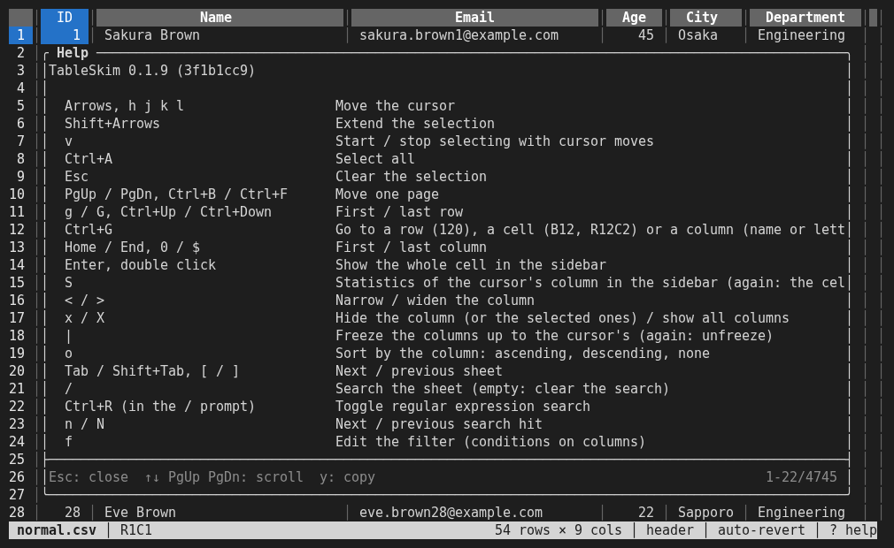

## Moving and selecting

| Key                                  | Action                         |
| ------------------------------------ | ------------------------------ |
| Arrows, `h` `j` `k` `l`              | Move the cursor                |
| `PgUp` / `PgDn`, `Ctrl+B` / `Ctrl+F` | Move one page                  |
| `g` / `G`, `Ctrl+Up` / `Ctrl+Down`   | First / last row               |
| `Home` / `End`, `0` / `$`            | First / last column            |
| `Shift`+arrows                       | Extend the selection           |
| `v`                                  | Start / stop selecting with cursor moves |
| `Ctrl+A`                             | Select all                     |
| `Esc`                                | Clear the selection; while exporting or converting, cancel it instead |
| `<` / `>`                            | Narrow / widen the column      |

The mouse also works: click a cell to move the cursor, double-click to show
the cell in the sidebar, use the wheel to scroll, and click a sheet tab to
switch sheets.

## The sidebar: cell contents and statistics

- `Enter` (or a double click) shows the whole value of the current cell in
  the sidebar, which is useful for long text.
- `S` shows the statistics of the current column: rows, empty cells,
  distinct values, minimum and maximum (and the sum, mean and standard
  deviation for numbers), and the most frequent values. Press `S` again to
  go back to the cell.
- `s` shows or hides the sidebar.

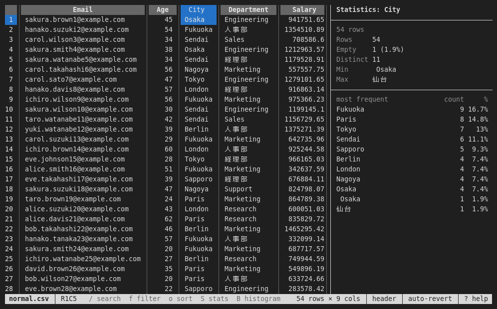

## Histograms

[Charts and Group By](charts.md) shows, with examples, how to read the
charts and the Group By results.

`B` shows a histogram of the current column in place of the sheet. The title
line summarizes what was counted, and each line is one bar with its range,
count and percentage.

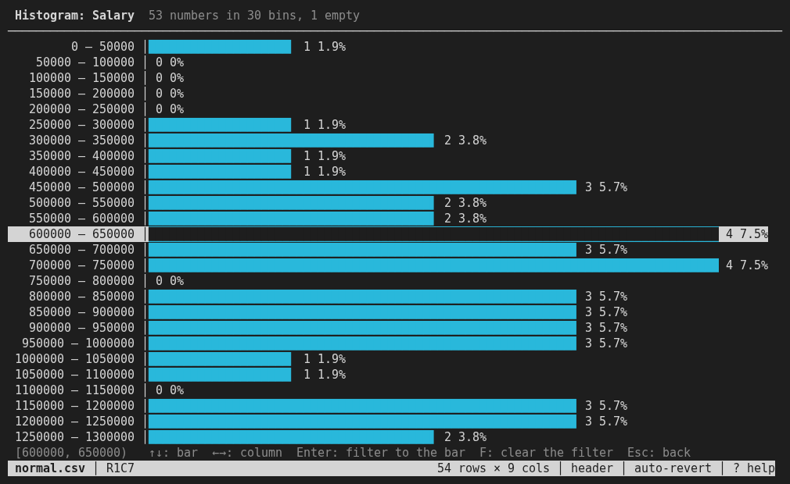

| Key                  | Action                                                   |
| -------------------- | -------------------------------------------------------- |
| `↑` / `↓`, `k` / `j` | Select a bar; its exact range is shown at the bottom      |
| `←` / `→`, `h` / `l` | Histogram of the previous / next column                   |
| `Enter`              | Filter the sheet to the rows of the selected bar          |
| `F`                  | Clear the filter                                          |
| `Esc`, `B`, `q`      | Back to the sheet                                         |

As in the GUI, numbers are counted into about 30 bins of round widths,
dates into bins of whole days, months, years and so on, and text columns
show their most frequent values. After `Enter`, the histogram is computed
again for the rows left, so you can narrow down step by step; press `Esc`
to see the filtered sheet.

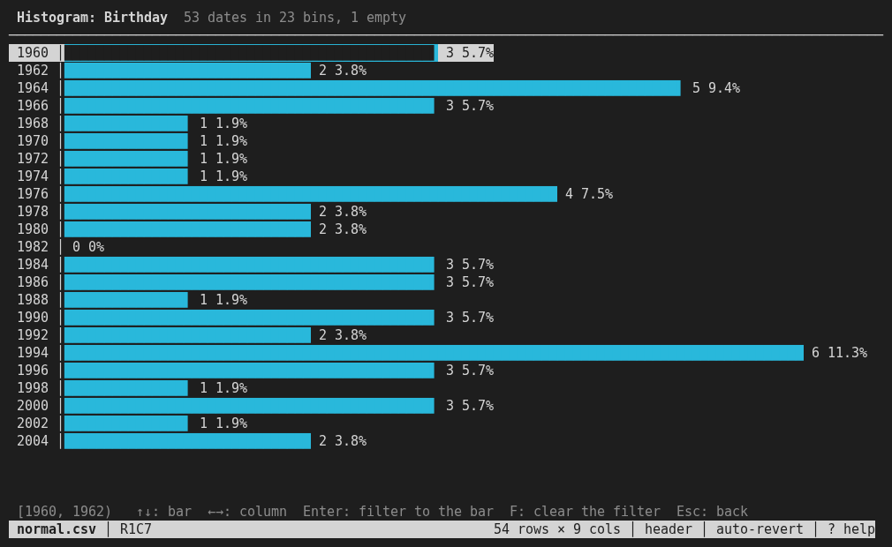

## 2D density

`M` shows how two columns relate, in place of the sheet: the first and last
of the selected columns on the horizontal (X) and vertical (Y) axes, or
else columns holding numbers or dates chosen as in the
[GUI](gui.md#scatter-plots-and-2d-density): Y is the cursor's column or the
nearest such one, X the nearest such one to its left. The plot
is a grid of cells, each coloured by the number of rows whose X and Y
values fall in it, from dark purple (few) to yellow (many); empty cells
stay blank. The grid is sized to the terminal. The densest cell is selected
first, and the line at the bottom shows its ranges and count. The title line
also shows Pearson's correlation coefficient *r*, *R²* and the
least-squares line of the rows plotted, as in the GUI.

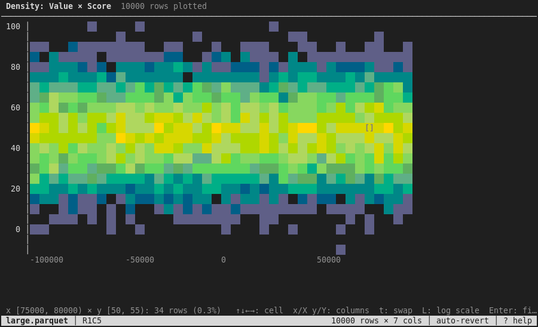

| Key                  | Action                                                   |
| -------------------- | -------------------------------------------------------- |
| Arrows, `h j k l`    | Select a cell                                             |
| `x` / `X`            | Next / previous column on X                               |
| `y` / `Y`            | Next / previous column on Y                               |
| `t`                  | Swap X and Y                                              |
| `L`                  | Logarithmic / linear colour scale                         |
| `Enter`              | Filter the sheet to the rows of the selected cell         |
| `F`                  | Clear the filter                                          |
| `Esc`, `M`, `q`      | Back to the sheet                                         |

Y must hold numbers or dates, as for the GUI's [scatter
plot](gui.md#scatter-plots-and-2d-density). The colours need a terminal
with 256 or more colours.

When X holds text, each of its 30 most frequent values (and **(other)** for
the rest) gets a line of its own, showing a **box plot** of its Y values:
the whiskers `├──┤`, the box `███` from the first to the third quartile,
the median `┃` and outliers `∘`, on a common scale. The line at the bottom
shows the numbers of the selected category.

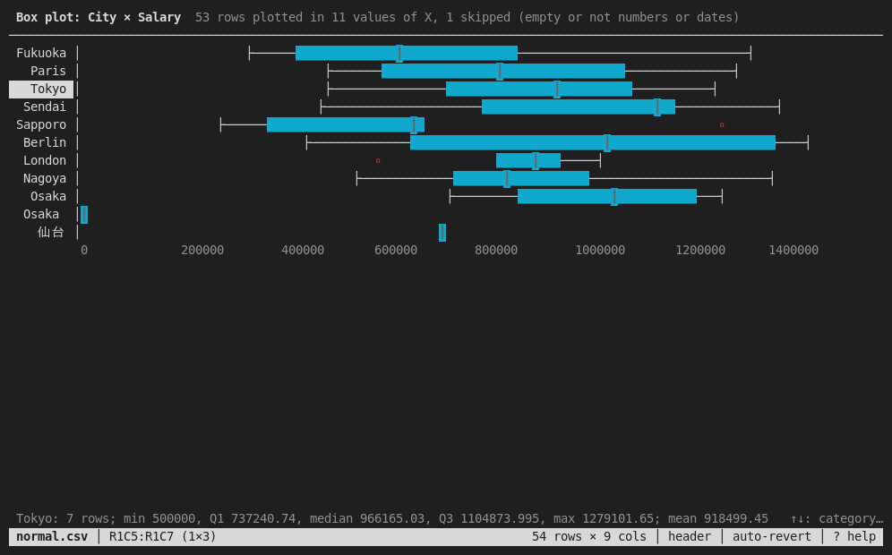

| Key (box plot)       | Action                                                   |
| -------------------- | -------------------------------------------------------- |
| `↑` / `↓`, `k` / `j` | Select a category                                         |
| `b`                  | The density instead (a column per category); again: back  |
| `Enter`              | Filter the sheet to the selected category                 |

## Group By

`A` counts the rows of the current sheet (sorted and filtered as shown) by
the values of some columns and shows the result in a new sheet named
**Group By**, as the GUI's [Group By](gui.md#group-by) does. A dialog lists
the columns: the selected ones (or the cursor's) are checked to group by.

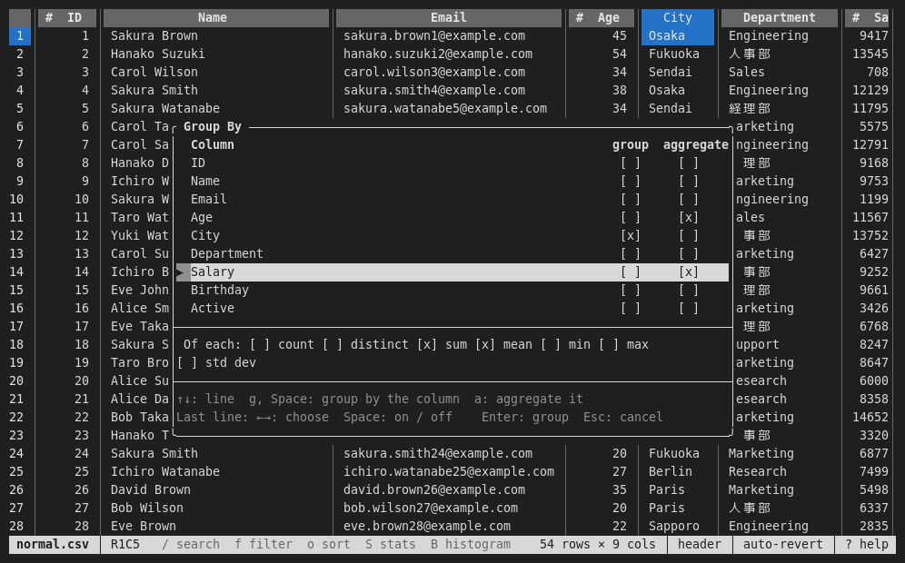

| Key                  | Action                                                   |
| -------------------- | -------------------------------------------------------- |
| `↑` / `↓`, `k` / `j` | Move between the columns and the last line               |
| `g`, `Space`         | Group by the column (again: not)                          |
| `a`                  | Aggregate the column (again: not)                         |
| `←` / `→`, `Space`   | On the last line: choose a function, turn it on or off    |
| `Enter`              | Group the rows                                            |
| `Esc`                | Close without grouping                                    |

The functions are **count** (non-empty values), **distinct**, **sum**,
**mean**, **min**, **max** and **std dev**; each one makes a column for
each aggregated column, after the group columns and **count**, the rows of
the group. The status bar shows the progress, and `Esc` cancels. The
sheet stays when the file is reloaded; grouping again replaces it.

## Sorting

`o` sorts by the current column: ascending, then descending, then back to
the file order.

## Filtering

### Quick filters

On a cell, `=` keeps only the rows with the same value in that column, and
`!` keeps only the rows with a different value. `F` clears the filter.

### The filter dialog

`f` opens the filter dialog, which edits the same kind of filter as the GUI
Filter pane.

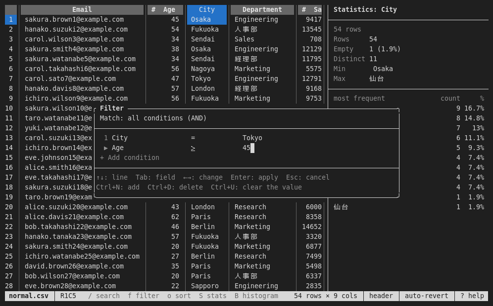

| Key           | Action                                                       |
| ------------- | ------------------------------------------------------------ |
| `↑` / `↓`     | Move between lines (the Match line, the conditions, "Add condition") |
| `Tab`         | Move between the fields of a condition: column, operator, value |
| `←` / `→`     | Change the column or the operator; on the Match line, switch between all (AND) and any (OR) |
| typing        | Edit the value                                                |
| `Ctrl+N`      | Add a condition                                               |
| `Ctrl+D`      | Delete the condition                                          |
| `Ctrl+U`      | Clear the value                                               |
| `Enter`       | Apply the filter (on "Add condition": add a condition)        |
| `Esc`         | Close without applying                                        |

The status bar shows how many rows match and the filter in use:

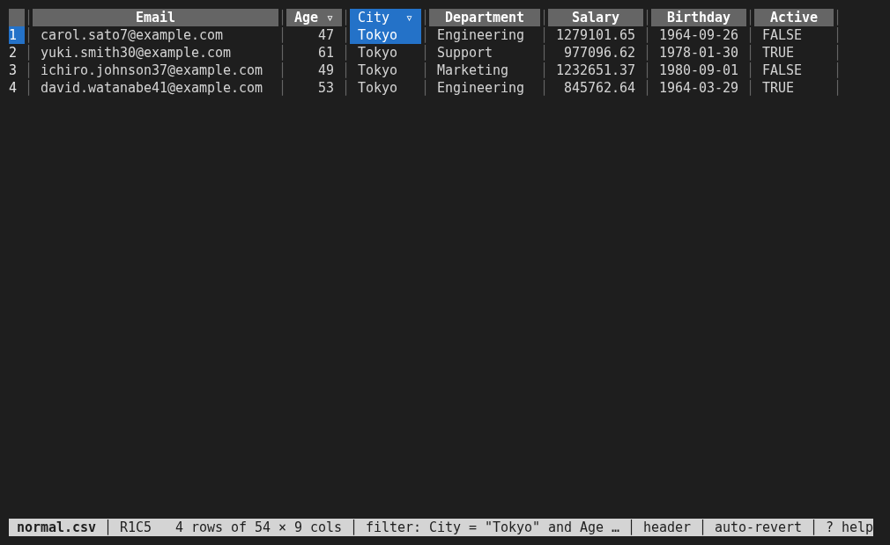

The operators and how values are compared are described in [Sorting,
Filtering, Searching and Statistics](filtering.md).

## Searching

`/` opens the search prompt at the bottom. Type the text and press `Enter`.
`Ctrl+R` in the prompt toggles regular expression search. `n` / `N` move to
the next / previous hit; the status bar shows the query and the hit number
(`/watanabe 1/20`). An empty search clears the search.

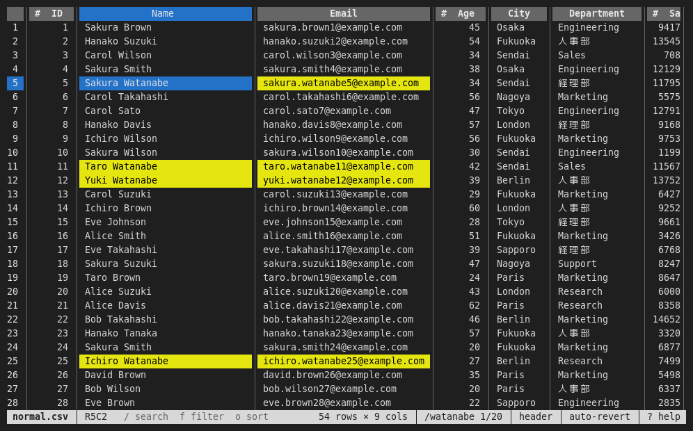

## Going to a row, cell or column

`Ctrl+G` asks for a row (`120`), a cell (`B12` or `R12C2`) or a column (its
letter or name), as in the GUI.

## Hiding and freezing columns

- `x` hides the current column (or the selected columns); `X` shows all
  columns again.
- `|` freezes the columns up to the cursor, so that they stay in place when
  scrolling sideways; press `|` again to unfreeze.

## Column types and formats

The mark before a column name is judged from the first 1,000 rows read, as
in the [GUI](gui.md#column-types-and-formats): `#` numbers, `@` dates and
date-times, `?` booleans; text and mixed columns have none.

`%` changes how the current column (or the selected columns) shows its
values. The dialog also shows the column's type.

| Line                | `←` / `→`, `Space`                                       |
| ------------------- | -------------------------------------------------------- |
| Thousands separator | On / off: `1234567.5` is shown as `1,234,567.5`          |
| Decimal places      | As stored, or 0 to 6 places (rounded)                    |
| Date format         | `2024-01-31`, `2024/01/31`, `01/31/2024`, `31/01/2024`, `2024年1月31日`, `Jan 31, 2024` |

`↑` / `↓` move between the lines, `Delete` resets the format, `Enter`
applies it and `Esc` closes the dialog. Only the display changes: sorting,
filtering, copying and exporting use the values as they are.

## Copying

`y` or `c` copies the selection (or the current cell) as tab-separated text.

Copying uses the OSC 52 escape sequence, so it also works over SSH: the text
goes to the clipboard of the computer where your terminal runs. The terminal
must allow OSC 52; inside tmux, enable `set-clipboard`:

```tmux
set -g set-clipboard on
```

## Sheets

`Tab` / `Shift+Tab` (or `]` / `[`) switch to the next / previous sheet. You
can also click a tab.

## Running SQL

For DuckDB, SQLite, Parquet and JSON files, `:` opens the SQL prompt.

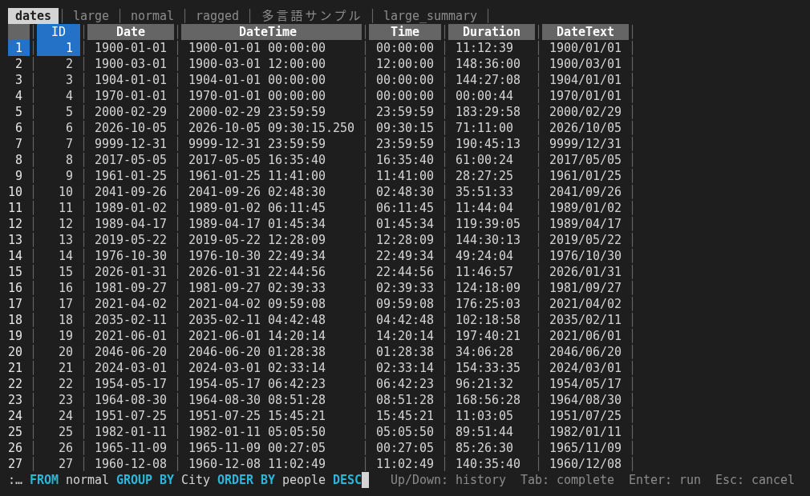

- `Enter` runs the query; a query result is shown as the sheet **SQL
  Result**.
- `Up` / `Down` recall SQL run before.
- `Tab` completes table names, column names and keywords.
- `Esc` cancels.

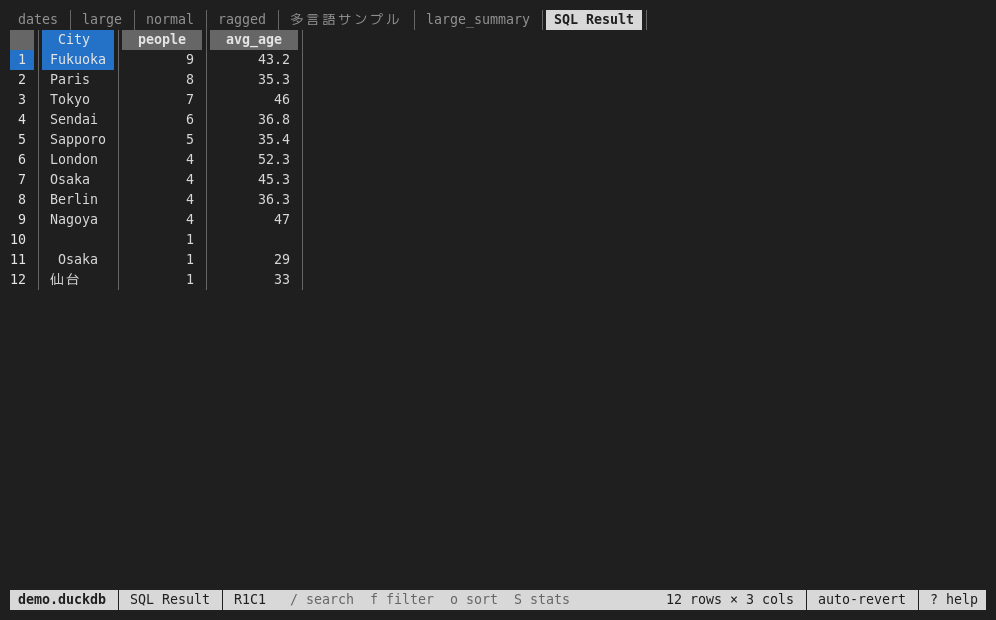

See [Running SQL](sql.md) for details.

## Exporting and converting

- `w` exports the current sheet as shown (sorted, filtered, without hidden
  columns). A prompt suggests a file name; the extension (`.csv`, `.tsv`,
  `.xlsx` or `.parquet`) selects the format.
- `P` / `D` convert a text file to Parquet / DuckDB next to the original
  file and open the result.

Progress is shown in the status bar; `Esc` cancels (instead of clearing
the selection). Until it has finished, the file is not reopened: `r`, `H`,
`#` and `E` ask you to wait, and Auto Revert waits. If the target file
exists, TableSkim asks `Overwrite? (y/n)`. See [Exporting and
Converting](exporting.md).

## Editing cells

Cells of CSV / TSV and Excel files can be changed in edit mode only: `I`
turns it on and off, and the status bar shows `EDIT`. Then `Enter`, `i`,
`F2` or a double click edits the cell in the status line, `Delete` clears
the selected cells, pasting into the terminal fills the selected cells with
tab-separated text, `u` / `Ctrl+R` undo and redo, and `Ctrl+S` saves the
file. Edited cells are green and the file name starts with `*` until
saved. Before unsaved changes would be lost (`q`, `r`, `H`, `#`, `E`, or
leaving edit mode), TableSkim asks: `y` saves, `n` discards, `Esc`
cancels. See [Editing Cells](editing.md).

## Following a growing file

`T` follows the end of the file, like `tail -f`: the file is checked every
second (with or without Auto Revert), and the cursor moves to the last row
whenever rows are added. The status bar shows `follow`. For CSV / TSV
files that are not compressed (in UTF-8 or Shift_JIS), only the appended
lines are read, and a line being written is shown once it ends. Other
files, and files that were rewritten rather than appended to, are
reloaded. Press `T` again to stop following.

## Other settings

| Key | Action                                                                |
| --- | --------------------------------------------------------------------- |
| `H` | Use the first row as header (CSV / TSV / Excel)                        |
| `#` | Skip lines starting with `##` (on by default for VCF)                  |
| `E` | Switch the text encoding: UTF-8, UTF-16LE, UTF-16BE, Shift_JIS (CP932) |
| `r` | Revert (reload the file)                                               |
| `R` | Toggle Auto Revert (reload the file when it changes)                   |
| `T` | Follow the end of the file as it grows (`tail -f`)                     |
| `e` | Show the file in the file browser                                      |

When the rows of a large CSV / TSV file take a lot of memory, the status bar
asks `Continue reading? (y/n)`, like the GUI (see [Supported File
Formats](file-formats.md#large-text-files-and-memory)).

Log messages are written only with `--log <file>`, because they would
otherwise be drawn over the screen.

## Key reference

See [Keyboard Shortcuts](keyboard-shortcuts.md#terminal-ui) for the full
list.
