# グラフと集計

[← 目次](README.md)

TableSkim では、表計算ソフトやスクリプトを使わずに、見ている行をグラフにしたり、表に集計したりできます。このページでは、どの問いにどの機能を使うか、結果の読み方、グラフから元の行へのたどり方を、例を交えて説明します。例では `demo/examples/` の `iris.csv`（花 150 個体）、`penguins.csv`（ペンギン 344 個体）、`hour.csv.xz`（自転車レンタルの毎時記録 17,379 行）を使います。入手先、単位、開き方は [サンプルデータ](examples.md) を参照してください。

- [問いに応じた機能の選び方](#問いに応じた機能の選び方)
- [1 つの列の分布：ヒストグラム](#1-つの列の分布ヒストグラム)
- [2 つの列の関係：散布図と密度分布](#2-つの列の関係散布図と密度分布)
- [グループごとの違い：箱ひげ図](#グループごとの違い箱ひげ図)
- [表に集計する：Group By](#表に集計するgroup-by)
- [グラフから行へ](#グラフから行へ)
- [グラフを画像として保存する](#グラフを画像として保存する)
- [ターミナル UI では](#ターミナル-ui-では)

## 問いに応じた機能の選び方

| 問い                                               | 機能                   | GUI                         | TUI |
| -------------------------------------------------- | ---------------------- | --------------------------- | --- |
| 列にどんな値が、それぞれいくつあるか               | ヒストグラム           | Edit → Histogram...         | `B` |
| 数値（または日付）の 2 列に関係はあるか            | 散布図、密度分布       | Edit → Scatter Plot...      | `M` |
| 数値がグループによってどう違うか                   | 箱ひげ図               | Scatter Plot（X がテキスト）| `M` |
| グループごとの行数、合計、平均は                   | Group By               | Edit → Group By...          | `A` |
| 1 つの列の最小・最大・平均は                       | 列の統計               | Edit → Column Statistics    | `S` |

どの機能も **現在の表示**、つまりフィルタで残った行を対象にします。先に絞り込んでから（たとえばある 1 年に）、その行だけをグラフにしたり集計したりできます。フィルタを変えるとグラフも追従します。

## 1 つの列の分布：ヒストグラム

ヒストグラムは、列の値が各範囲（区間）にいくつ入るかを数えます。現在のセルを列に置いて **Edit → Histogram...**（`Ctrl+Shift+H`）を選びます。

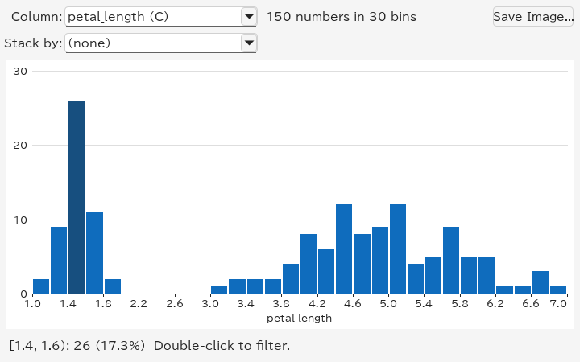

読み方：

- **形** は値の散らばり方を表します。この例では花びらの長さに離れた山があり、短い花びらは setosa に属します。**Stack by → species** で、それぞれの棒がどの品種からなるかを確認できます。
- 上の **概要** は数えたものを示します。「150 numbers in 30 bins」は、150 個の数値を 30 区間に数えたという意味です。Iris の花びらの長さには欠損値がありません。
- **棒を指す** と、正確な範囲と数を表示します。たとえば `[1.4, 1.6): 26 (17.3%)` は、花びらの長さが 1.4 cm 以上 1.6 cm 未満の花が 26 個体あるという意味です。

日付は日・月・年などの単位で数え、テキストの列は多い値から順に横棒で表示します。**Stack by** で別の列（地域など）を選ぶと、各棒をその列の値ごとに色分けして積み上げ、それぞれの範囲が何でできているかがわかります。すべての操作は [ヒストグラム](gui.md#ヒストグラム)、詳しい仕組みは [区間の決め方](filtering.md#区間の決め方) を参照してください。

## 2 つの列の関係：散布図と密度分布

散布図は、ある列を横（X）、別の列を縦（Y）にとって、1 行を 1 つの点として描きます。**Edit → Scatter Plot...**（`Ctrl+Shift+P`）を選びます。先に 2 つの列を選択しておくとその列を描き（最初の列が X）、選択していなければ現在のセルの近くにある数値・日付の列を選びます。**X** と **Y** の一覧で変えられます。

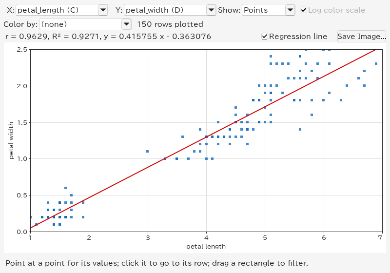

読み方：

- グラフの上の行は関係の強さを表します。**r**（ピアソンの相関係数）は −1〜1 の値で、1 に近いほど X が増えると Y も増え、−1 に近いほど X が増えると Y が減り、0 に近いと直線的な関係はありません。この例は `r ≈ 0.9629` で、花びらが長いほど幅も広い傾向があります。
- **R²** は Y のばらつきのうち直線で説明できる割合（ここでは約 92.7%）、`y = 0.4158 x − 0.3631` は赤で描かれた直線のおおよその式です。X と Y の単位はどちらも cm です。相関は因果関係を示すものではありません。
- **点を指す** と値と行番号を表示し、**クリック** するとシートのその行に移動します。
- **Color by** で 3 つ目の列（species など）を選ぶと、その列の値ごとに点を色分けし、グラフの上に凡例を表示します。グループどうしが離れているかどうかがわかります。凡例の項目をクリックすると、その値の行に絞り込みます。

**Color by → species** で品種別に色を付けると、品種ごとのまとまりが見えます。凡例をクリックするとその品種に絞り込めます。全体の相関には品種間の違いも含まれるため、品種内の関係を調べるときは先に品種で絞り込みます。

行が多いと点が重なり合います。**Show → Density** にすると、代わりにマス目ごとに行を数え、少ない（暗い色）から多い（黄色）まで色分けします。

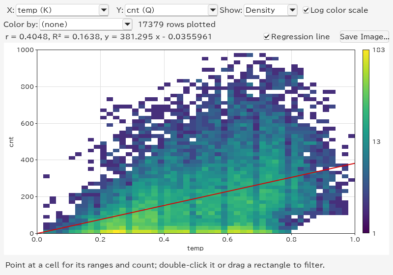

この例では Bike Sharing を開き、**X → temp**、**Y → cnt** にします。`temp` は正規化された気温（摂氏ではありません）、`cnt` は 1 時間のレンタル数です。需要は時刻、季節、勤務日にも左右されるため、気温だけでは説明できません。**Log color scale** をオンにすると、行の多いマスの隣でも数行しかないマスが見えるようになります。オフにすると数を線形に比べられます。

## グループごとの違い：箱ひげ図

X が `species` のようなテキストの列のときは、その値がそれぞれグループになって列を割り当てられ、グループごとの **箱ひげ図** を描きます。次の例は Iris の **X → species**、**Y → petal_length**（花びらの長さ）です。

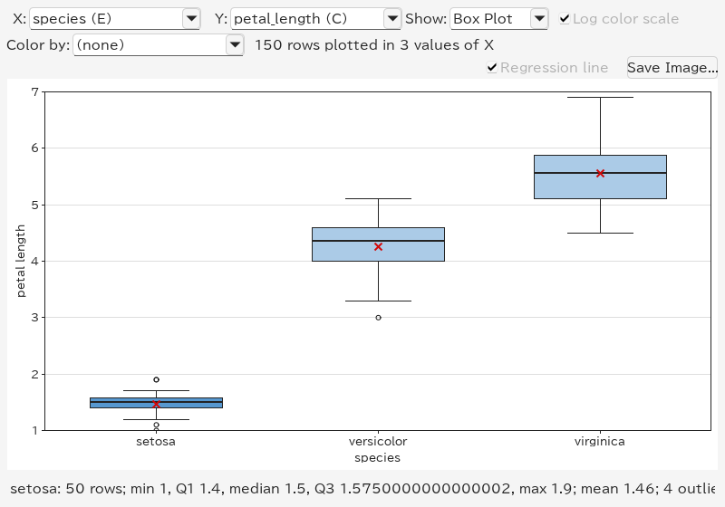

箱の読み方：

- **箱** はグループの値の真ん中の半分です。第 1 四分位数（値の 4 分の 1 がこれより小さい）から第 3 四分位数（4 分の 3 がこれより小さい）までで、箱が縦に長いほど値が散らばっています。
- 箱の中の **太線** が **中央値** で、値の半分がこれより小さく、半分が大きくなります。赤い **×** は **平均** です。平均が中央値から離れているときは、ごく一部の極端な値に引っぱられています。
- **ひげ** は、極端ではない（箱から箱の高さの 1.5 倍以内の）最小値・最大値まで伸びます。その外の **丸** が **外れ値** で、品種内で珍しい測定値を示しますが、必ずしもデータの誤りではありません。
- **箱を指す** と、行数、最小値、四分位数、最大値、平均をグラフの下に表示します。

中央値は setosa が 1.5 cm、versicolor が 4.35 cm、virginica が 5.55 cm で、品種間の違いがわかります。各品種は 50 個体ずつです。グループは多い順に最大 30 個表示し、残りはまとめて **(other)** として描きます。

グループの値が 1,048,576 個を超えると、箱ひげ図の統計はその件数の一様なサンプルから推定します。表示する行数はグループ全体の件数のままで、箱の数値にはサンプル数と推定値であることを表示します。最小値・最大値・外れ値の件数もサンプルに基づきます。密度分布の件数は全行を数えます。点を保持する場合と密度分布だけを計算する場合で、箱ひげ図のサンプルは変わりません。

別の例として `penguins.csv` を開き、**X → species**、**Y → body_mass_g** にします。Gentoo は Adelie や Chinstrap より重い傾向があります。体重が空の 2 行は除外され、342 個体が描かれます。

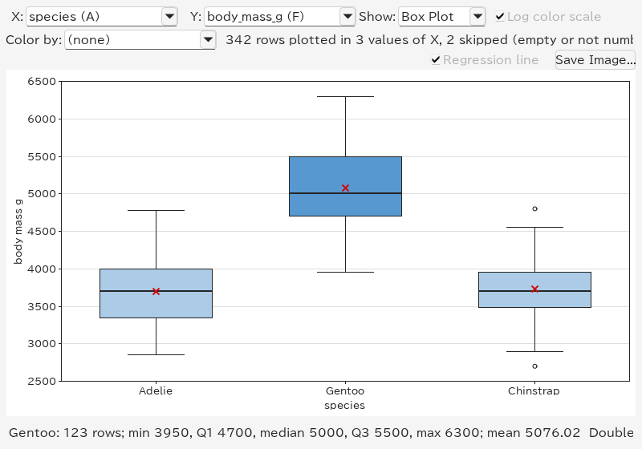

**Show → Density** にすると、各グループのヒストグラムを色付きのマスの列として表示します。山が 2 つあるかどうかなど、箱よりも形が詳しくわかります。

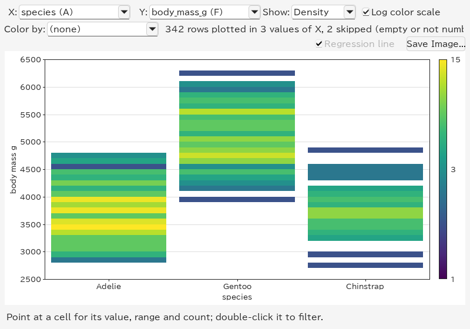

## 表に集計する：Group By

グラフは傾向を示し、**Group By** は数字を示します。**Edit → Group By...**（`Ctrl+Shift+G`）で、グループ化する列と要約する列を選ぶと、結果を **Group By** という新しいシートに表示します。

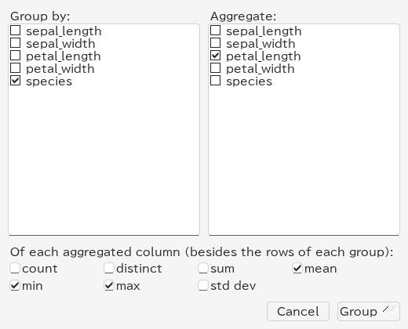

### グループごとの行数を数える

グループ化する列だけにチェックを付けて **Group** を押すと、値ごとに 1 行と、その **count**（行数）が並びます。**count** 列で並べ替える（並べ替えボタンを 2 回クリック）と、大きいグループから順に見られます。

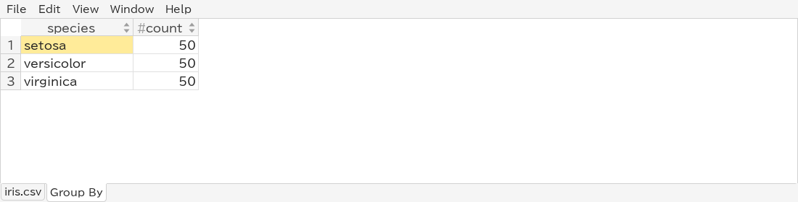

結果は setosa、versicolor、virginica の 3 行で、それぞれ `count = 50` です。Iris の品種には空の値がありません。

### グループごとの平均・最小・最大

**Aggregate** で列にチェックを付け、その下で関数を選びます：**count**（空でない値の数）、**distinct**（異なる値の数）、**sum**、**mean**、**min**、**max**、**std dev**（標準偏差）。要約した列と関数ごとに、`petal_length mean` のような列ができます。平均は小数点以下が長くなりがちなので、列見出しのメニューの **Format** で、たとえば小数点以下 3 桁に丸めて表示できます。

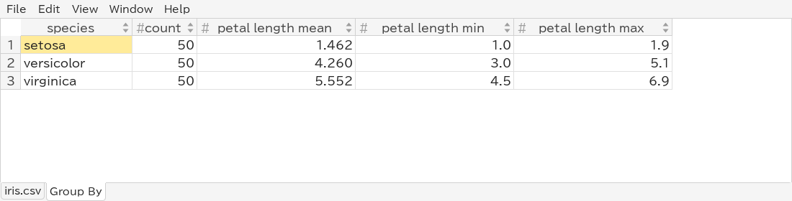

平均は setosa が 1.462 cm、versicolor が 4.260 cm、virginica が 5.552 cm です。箱ひげ図で見た品種間の違いを数字で確認できます。

### シート全体の合計

**Group by** の列にどれもチェックを付けないと、すべての行が 1 つのグループになり、合計などの 1 行が得られます。

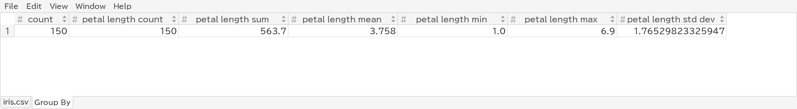

### 複数の列でグループ化する

**Group by** で 2 つ以上の列にチェックを付けると、組み合わせごとに数えます。たとえば `penguins.csv` の `species` と `island` なら、種と島の組み合わせごとに 1 行になります。

### 結果の使い方

**Group By** シートは普通のシートなので、並べ替え、フィルタ、グラフ（`count` のヒストグラムなど）、コピー、**File → Export View...** での保存ができます。もう一度集計すると置き換わります。ファイルを再読み込みしても残りますが、元のシートが変わっても更新されないので、フィルタを変えたら集計し直してください。値の比較方法は [集計（Group By）](filtering.md#集計group-by) を参照してください。

## グラフから行へ

グラフとフィルタは連動するので、段階的に絞り込めます。

- ヒストグラムの棒、密度分布のマス、箱を **ダブルクリック** すると、シートをその行に絞り込みます。数値の散布図では **長方形をドラッグ** すると、その中の行に絞り込みます。
- グラフは残った行で描き直されるので、さらに絞り込めます。
- **Edit → Clear Filter** ですべての行に戻ります。

上の箱ひげ図で setosa の箱をダブルクリックすると、50 個体が残ります。

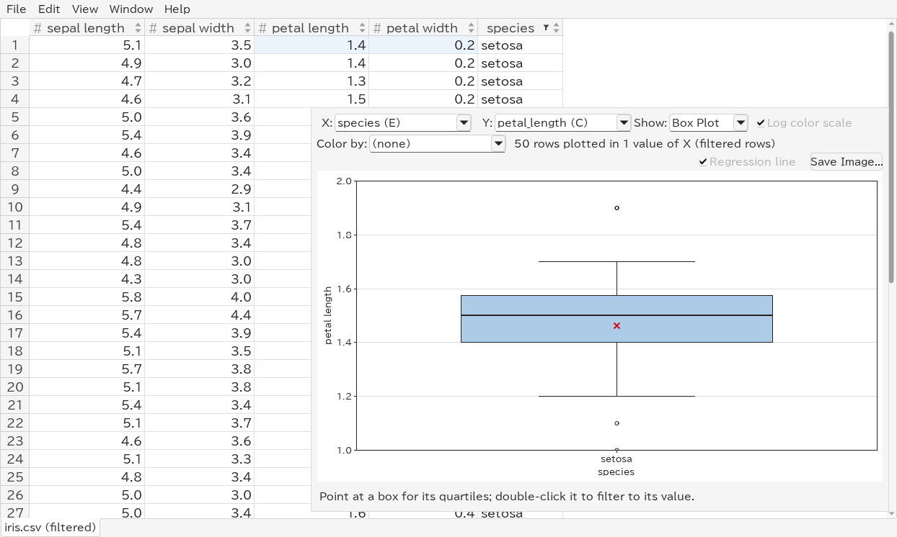

## グラフを画像として保存する

ヒストグラムと散布図のウィンドウの **Save Image...** で、グラフを軸の見出しも含めて表示どおりにファイルに書き出します。

- **PNG**（`.png`）：ウィンドウの大きさの画像です。スライド、文書、チャットに。
- **SVG**（`.svg`）：線や文字がどの大きさでもくっきり表示され、ベクター描画ソフトで編集できます。散布図の点は、SVG の中に画像として入ります。

種類は入力した名前の拡張子、またはファイルダイアログで選んだ種類で決まります。画像の大きさを変えるには、先にウィンドウの大きさを変えてください。

[Web アプリ](web.md#ヒストグラムと散布図) では、グラフのダイアログの **Save PNG** と **Save SVG** で同じように保存できます。ファイルはブラウザのダウンロード先に保存されます。散布図の点は SVG の中で個別の図形になります。

## ターミナル UI では

ターミナル UI にも、文字で描く同じ機能があります。

- `B` でカーソルのある列のヒストグラムを表示し、`Enter` で棒に絞り込みます。`g` / `G` で棒を別の列で積み上げます。
- `M` で 2 つの列（先に選択）の密度分布、X がテキストのときは箱ひげ図を表示します。`b` で箱ひげ図と密度分布を切り替え、`Enter` で箱やマスに絞り込みます。
- `A` で Group By ダイアログを開きます。結果はシートになり、`o` で並べ替えられます。
- `%` で、GUI の **Format** と同じく現在の列の表示形式を変えます。

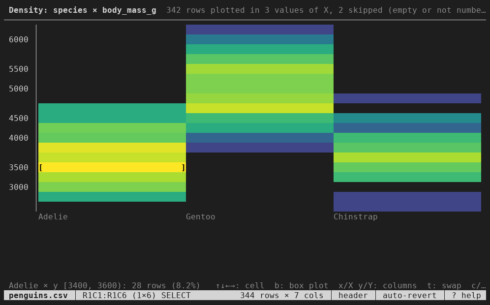

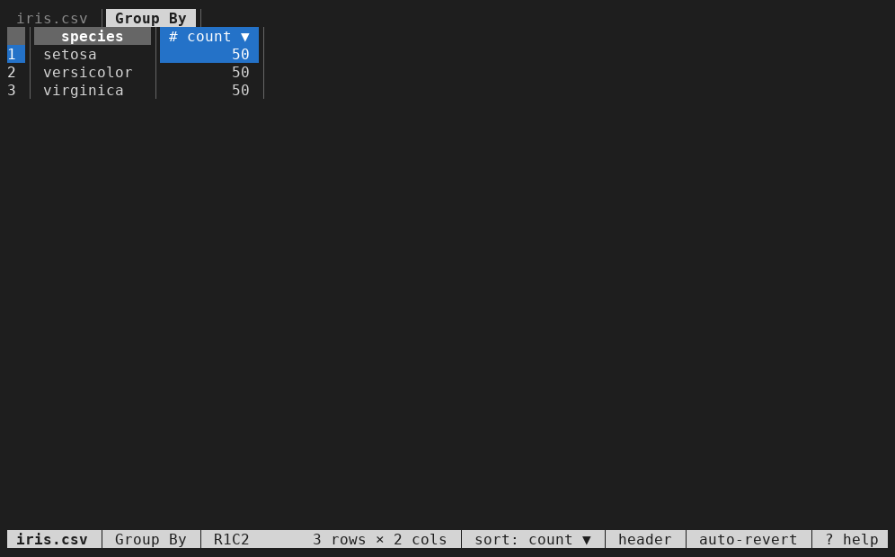

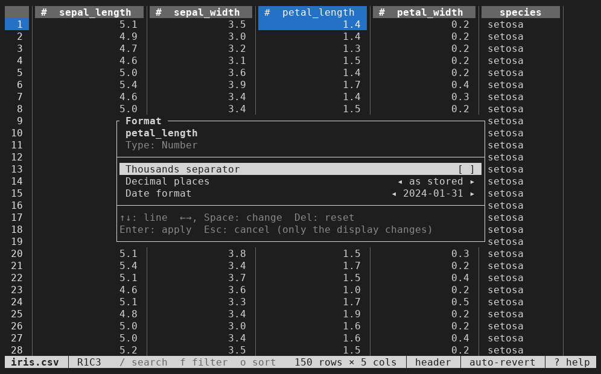

すべてのキーは [ターミナル UI の使い方](tui.md) を参照してください。グラフの画像保存は GUI でのみ使えます。
