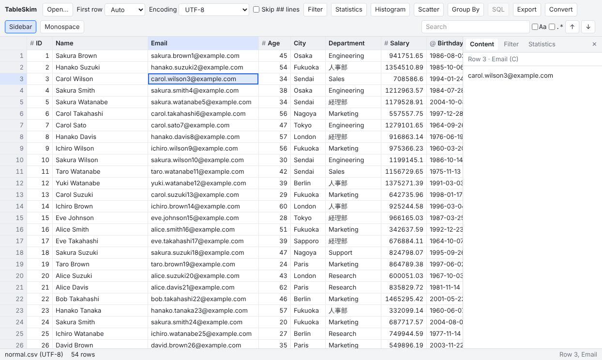
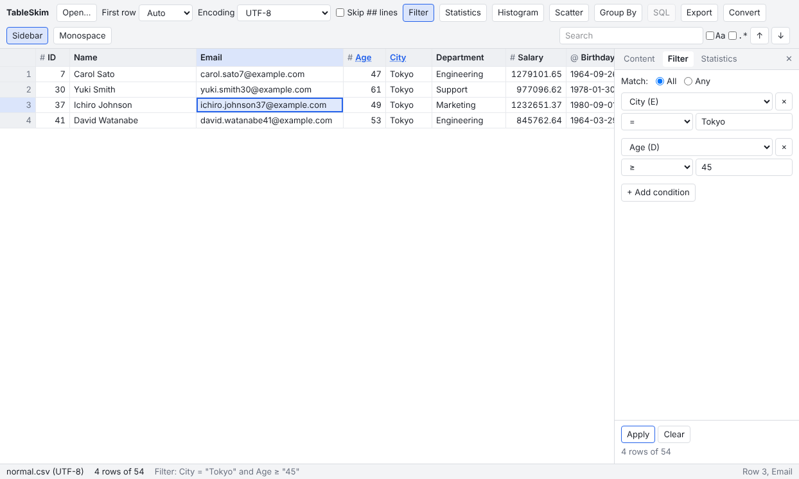
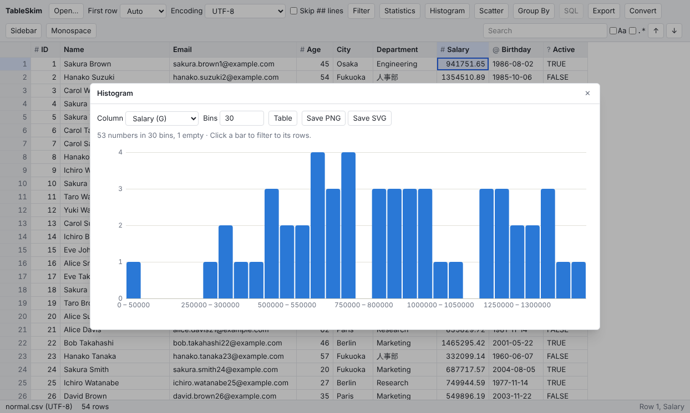
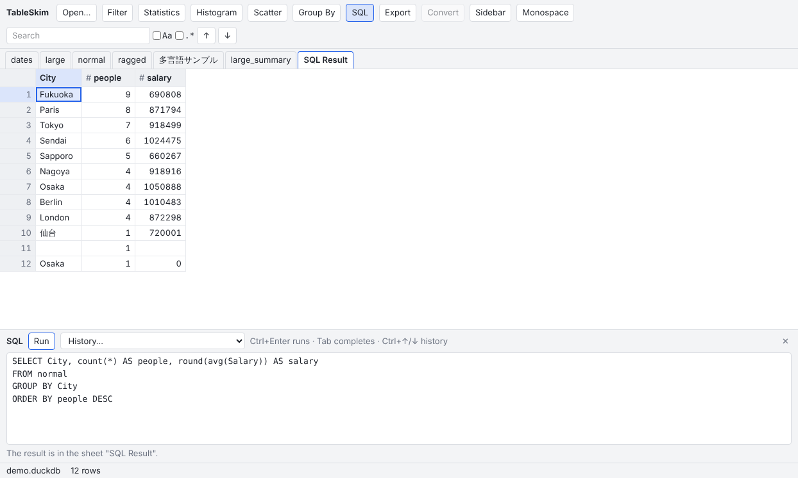

# Web アプリの使い方

[← 目次](README.md)

- [Web アプリとは](#web-アプリとは)
- [設置](#設置)
- [画面の構成](#画面の構成)
- [ファイルを開く](#ファイルを開く)
- [移動と選択とコピー](#移動と選択とコピー)
- [指定した位置へ移動](#指定した位置へ移動)
- [サイドバー](#サイドバー)
- [並べ替え](#並べ替え)
- [フィルタ](#フィルタ)
- [検索](#検索)
- [列の統計](#列の統計)
- [ヒストグラムと散布図](#ヒストグラムと散布図)
- [集計（Group By）](#集計group-by)
- [列の非表示と固定](#列の非表示と固定)
- [列の型と表示形式](#列の型と表示形式)
- [シート](#シート)
- [SQL の実行](#sql-の実行)
- [エクスポートと変換](#エクスポートと変換)
- [大きなテキストファイル](#大きなテキストファイル)
- [GUI との違い](#gui-との違い)
- [キーボードショートカット](#キーボードショートカット)

macOS では、このページの `Ctrl` を `Cmd` に読み替えてください。

## Web アプリとは

Web アプリは、Web ブラウザの中で動く TableSkim です。GUI やターミナル UI と同じコアを WebAssembly にしたものがブラウザの中でファイルを読むので、**開いたファイルはアップロードされません**。使うコンピューターに何かをインストールする必要もありません。開けるファイル形式は他の画面と同じで（[対応ファイル形式](file-formats.md) を参照）、機能もほとんど同じです。使えない機能は [GUI との違い](#gui-との違い) にまとめています。



## 設置

Web アプリは静的なファイルだけのフォルダで、`tableskim-<version>-web.zip` として配布しています。このフォルダを Web サーバーの好きな場所に置き、フォルダの URL を末尾の `/` 付きで開いてください（例：`https://example.com/tools/tableskim/`）。サーバー側で動くプログラムはありません。

- ページは **HTTPS**、または `http://localhost` / `http://127.0.0.1` で配信する必要があります。`index.html` をファイルとして開いても動きません。
- コアは複数のスレッドで動きます。ブラウザがこれを許すのは *cross-origin isolated* なページだけです。設定できるサーバーでは、フォルダ内のすべてのファイルに次のヘッダーを付けてください。

  ```text
  Cross-Origin-Opener-Policy: same-origin
  Cross-Origin-Embedder-Policy: require-corp
  ```

  ヘッダーを設定できないサーバー（GitHub Pages など）では、ページが自分のフォルダだけを対象にヘッダーを付ける Service Worker を登録し、一度だけ読み込み直します。それでも cross-origin isolated で配信する必要があると表示される場合は、サーバーかブラウザがどちらも許していません。
- 自分のコンピューターで試すには、フォルダで `python3 -m http.server 8000` を実行し、`http://localhost:8000/` を開きます。

新しいブラウザを使ってください。Web アプリは Chromium（Google Chrome、Microsoft Edge）でテストしています。

## 画面の構成

- 上端の **ツールバー**：**Open...**、ファイルの読み方の設定（**First row**、**Encoding**、**Skip ## lines**。使えるファイルのときだけ表示）、各機能のボタン（**Filter**、**Statistics**、**Histogram**、**Scatter**、**Group By**、**SQL**、**Export**、**Convert**、**Sidebar**、**Monospace**）、検索欄。ファイルに使えないボタンは薄く表示され、押された状態のボタンはそのパネルが開いていることを表します。
- ツールバーの下の **シートのタブ**：複数のシートがあるファイルのとき表示されます。
- **列見出し**：列名、列が何を含んでいそうかを表す印（`#` は数値、`@` は日付、`?` は真偽値）、並べ替えの矢印。フィルタが掛かっている列の名前は強調色の下線付きになります。
- **行番号**：現在の表示（並べ替え・フィルタ後）での行の位置です。
- 右側の **サイドバー**（最初は非表示）：Content、Filter、Statistics の各ペイン。
- 下端の **ステータスバー**：ファイル名とその文字コード、行数（フィルタ中は `4 rows of 54` など）、フィルタの内容、カーソルの行と列。

ページはシステムのライト／ダークの外観に合わせて表示されます。

## ファイルを開く

- **Open...**（`Ctrl+O`）を押してファイルを選ぶか、ページのどこかにファイルをドロップします。
- 1 つのページに表示できるファイルは 1 つで、別のファイルを開くと置き換わります。2 つのファイルを並べて見るには、Web アプリをブラウザの 2 つのタブで開いてください。
- テキストファイル（CSV、TSV、VCF）では次の設定が使えます。
  - **First row**：1 行目を見出しとして扱うかを選びます（**Auto**、**Header**、**Data**）。GUI と同じです。Excel ファイルでも表示されます。
  - **Encoding**：検出した文字コードを表示し、別の文字コード（UTF-8、UTF-16LE、UTF-16BE、Shift_JIS (CP932)）で読み直します。
  - **Skip ## lines**：VCF ファイルのメタ情報など、`##` で始まる行を読み飛ばします。VCF ファイルでは最初からオンです。

  どれかを変えるとファイルを開き直し、ほかの設定はそのまま保たれます。[対応ファイル形式](file-formats.md#csvtsvその他のテキストファイル) も参照してください。

## 移動と選択とコピー

- 矢印キー、`Page Up` / `Page Down`、`Home` / `End` でカーソルを動かします。`Ctrl+Home` / `Ctrl+End` で最初／最後の行へ移動します。テキストファイルを読み込み中のときは、`Ctrl+End` のあと最後の行を追い続けます。
- セルをクリックして選択し、`Shift+クリック` やドラッグで範囲を選択します。移動キーと `Shift` で選択を広げられます。行番号をクリックするとその行を選択します。`Ctrl+A` ですべてを選択します。
- 列見出しの右端をドラッグすると列の幅を変えられます。
- `Ctrl+C`、またはセルのメニューの **Copy** で、選択範囲をタブ区切りのテキストとしてコピーします（非表示の列は除かれます）。そのまま表計算ソフトに貼り付けられます。一度にコピーできるのは 100,000 行までです。まだ読み込まれていない行は除かれ、ステータスバーにその旨が表示されます。

セルや列見出しを右クリックするとメニューが開きます。コピー、クイックフィルタ、並べ替え、列の統計、グラフと集計、表示形式、列の非表示と固定が使えます。

## 指定した位置へ移動

`Ctrl+G` で **Go To** を開きます。行番号（`120`）、列の記号（`C`）、見出しの名前、セル（`C120`）を入力して `Enter` を押します。GUI と同じです。

## サイドバー

**Sidebar** ボタンでサイドバーを表示・非表示にします。タブは次のとおりです。

- **Content**：選択しているセル（範囲のときは左上のセル）の値全体を、ペインの幅で折り返し、改行も含めて表示します。グリッドでは長い値が途中で切れますが、ここでは全体が見えます。セルで `Enter` を押すかダブルクリックすると開きます。
- **Filter**：フィルタの条件です（[フィルタ](#フィルタ) を参照）。
- **Statistics**：カーソルのある列の統計です（[列の統計](#列の統計) を参照）。

サイドバーの左端をドラッグすると幅を広げられます。幅はブラウザに保存されます。

## 並べ替え

列見出しをクリックすると、その列で並べ替えます。1 回目は昇順、2 回目は降順、3 回目でファイルの順に戻ります。列のメニューには **Sort Ascending**、**Sort Descending**、**Clear Sort** があります。値の比較方法は [並べ替え・フィルタ・検索・統計](filtering.md#並べ替え) を参照してください。

## フィルタ

**Filter** ボタン（`Ctrl+Shift+F`）でサイドバーの Filter ペインを開きます。配置は GUI と同じです。



- **Match: All / Any**：すべての条件に合う行（AND）か、いずれかの条件に合う行（OR）を表示します。
- 各条件は **列**、**演算子**、**値** からなります。**×** ボタンでその条件を削除します（すぐに反映されます）。
- **+ Add condition** で、カーソルのある列の条件を追加します。
- **Apply**（または値の欄で `Enter`）でフィルタを適用します。それまでは下の行に "Press Apply (or Enter) to filter." と表示されます。適用後は結果（例："4 rows of 54"）か、適用できない理由（正規表現の誤りなど）が表示されます。
- **Clear** ですべての条件を削除します。

列やセルのメニューの **Filter by This Column...** は、その列の条件を追加した状態でペインを開きます。**Clear Filter** はフィルタを解除します。

**クイックフィルタ**：セルを右クリックし、**Filter: Equal to This Value** または **Filter: Not Equal to This Value** を選びます。クイックフィルタはそのたびに条件として追加されます。

ヒストグラムの棒や密度分布のセルをクリックすると、行がさらに絞り込まれます。この絞り込みは **Additional narrowing (N) - Clear** として表示され、**Match: Any** を選んでいても条件と AND で組み合わされます。このボタンで絞り込みだけを解除でき、**Clear** は条件とまとめて解除します。

演算子と値の比較方法は [並べ替え・フィルタ・検索・統計](filtering.md#フィルタ) を参照してください。

## 検索

右上の検索欄（`Ctrl+F` で移動します）に入力して `Enter` を押すと、カーソルが次のヒットへ移動し、表示中のヒットがすべて強調されます。`Enter` と `Shift+Enter`、または **↑** / **↓** ボタンで次／前のヒットへ移動し、`Escape` でグリッドに戻ります。**Aa** は大文字と小文字を区別し、**.\*** は入力を正規表現として扱います。検索欄にはそれまでに見つかったヒットの数が表示されます。

## 列の統計

**Statistics** ボタン、または列のメニューの **Statistics** で Statistics ペインを表示します。カーソルのある列について、表示中の行の行数と空のセルの数、値の種類数、最小値と最大値、数値の平均と標準偏差、出現回数の多い値を表示します。カーソルを別の列に動かすと、その列の統計に切り替わります。[列の統計](filtering.md#列の統計) も参照してください。

## ヒストグラムと散布図

- **Histogram** は、カーソルのある列の値の分布を表示します。列と区間の数を選べます。**Table** で件数を表として表示します。棒をクリックすると、その区間の行に絞り込みます。

  

- **Scatter** は 2 つの列の関係を表示します。**Points**（点）、**Density**（密度）、X が文字列のときはカテゴリごとの **Box plots**（箱ひげ図）から選べ、最小二乗法の **Regression line**（回帰直線）も表示できます。点をクリックするとその行へ移動し、密度のセルや箱をクリックするか、矩形をドラッグすると、その範囲の行に絞り込みます。

**Save PNG** と **Save SVG** は、表示しているグラフをそのまま保存します。ファイルはブラウザのダウンロード先に保存されます。PNG はページ上の 2 倍の大きさで描かれ、SVG はどの大きさでも線や文字がくっきり表示されます。

グラフの読み方や、問いに応じたグラフの選び方は [グラフと集計](charts.md) を参照してください。

## 集計（Group By）

**Group By** は、表示中の行をキー列の値でグループに分け、ほかの列の集計値（count、distinct、sum、mean、min、max）を求めます。GUI と同じです。各列の **Key** と **Aggregate** のチェックボックスと、求める集計値を選びます。結果は **Group By** という名前のシートとして開き、次の Group By で置き換わります。[表に集計する：Group By](charts.md#表に集計するgroup-by) を参照してください。

## 列の非表示と固定

列のメニューから次の操作ができます。

- **Hide Column** で列を非表示にし、**Show N Hidden Columns** で再び表示します。ステータスバーに非表示の列の数が表示されます。
- **Freeze Up to This Column** で、その列までを横にスクロールしても表示したままにします。**Unfreeze Columns** で解除します。

非表示の列はコピー、エクスポート、Group By から除かれます。並べ替え、フィルタ、検索には影響しません。GUI と同じです。

## 列の型と表示形式

列のメニューの **Format...** で、その列の数値（桁区切り、小数点以下の桁数）と日付の表示形式を選びます。変わるのは表示だけで、コピーやエクスポートでは元の値が使われます。[列の型と表示形式](gui.md#列の型と表示形式) を参照してください。

**Monospace** ボタンで、セルと Content ペインを等幅フォントで表示します。配列やコードのような固定幅のデータが揃って見えます。この設定はブラウザに保存されます。

## シート

Excel ブックや DuckDB / SQLite データベースでは、グリッドの上にシートやテーブルごとのタブが表示されます。SQL の結果や Group By の結果もシートとして追加されます。

## SQL の実行

DuckDB、SQLite、Parquet、JSON ファイルでは、**SQL** ボタンでページ下部に SQL パネルを開きます。



クエリを入力して **Run**（`Ctrl+Enter`）を押すと、結果が **SQL Result** シートとして開きます。次のクエリで置き換わり、ほかの設定でファイルを開き直したときは最後のクエリを再実行します。`Tab` でテーブル名や列名を補完し、`Ctrl+↑` / `Ctrl+↓`（または **History...**）で以前のクエリを呼び出せます。履歴はブラウザに保存され、GUI やターミナル UI の履歴とは別です。クエリできるものは [SQL の実行](sql.md) を参照してください。

## エクスポートと変換

- **Export** は、シートを表示どおり（並べ替えとフィルタを適用し、非表示の列を除いて）CSV、TSV、Excel、Parquet で保存します。[Export View](exporting.md#export-view) を参照してください。
- **Convert**（テキストファイルのみ）は、ファイル全体を Parquet または DuckDB データベースに変換します。表示どおりの読み方（文字コード、1 行目、`##` 行）で読み、各列には値がすべて収まる最も狭い型を付けます。並べ替えとフィルタは適用されません。[Convert to Parquet / DuckDB](exporting.md#convert-to-parquet--duckdb) を参照してください。

どちらもバックグラウンドで実行され、行数と **Stop** ボタンが表示されます。ファイルはブラウザのメモリに書き出されたあと、元のファイル名にちなんだ名前でブラウザのダウンロード先に保存されます。

## 大きなテキストファイル

ファイルはその場で少しずつ読まれ、全体がメモリにコピーされることはありません。テキストファイルの行は GUI と同じく一度読むとメモリに保持されるので、行が 100 MiB、500 MiB、1 GiB、以降 2 GiB ごとに達すると読み込みが一時停止します。**Continue reading** で続きを読み、**Stop here** で読んだところまでを表とします。ブラウザがページに与えるメモリはプログラムよりずっと少なく、最大でも 4 GiB です。とても大きなテキストファイルは、先に GUI やターミナル UI で Parquet に変換しておくとよいでしょう。Parquet ファイル、データベース、Excel ブックは必要な分だけ読まれます。

## GUI との違い

Web アプリには、次のものを除いて GUI の機能がそろっています。

- セルの編集、**Follow End of File**、**Auto Revert** はありません。ブラウザはファイルに書き込むことも、ファイルの変更を知ることもできないためです。
- ページで開くファイルは 1 つで、ページから開きます。最近使ったファイル、コマンドラインオプション、**Show File in File Browser** はありません。
- SQL の履歴、等幅フォントの設定、サイドバーの幅はブラウザに保存され、GUI の設定とは別です。
- 検索はサイドバーではなくツールバーにあります。

## キーボードショートカット

| キー                        | 動作                                                      |
| --------------------------- | --------------------------------------------------------- |
| `Ctrl+O`                    | ファイルを開く                                            |
| 矢印、`Page Up` / `Page Down`、`Home` / `End` | カーソルを動かす                        |
| `Ctrl+Home` / `Ctrl+End`    | 最初／最後の行                                            |
| `Shift` + 移動キー          | 選択を広げる                                              |
| `Ctrl+A`                    | すべてを選択                                              |
| `Ctrl+C`                    | 選択範囲をタブ区切りでコピー                              |
| `Enter`、ダブルクリック     | セルの値全体をサイドバーに表示                            |
| `Ctrl+G`                    | Go To                                                     |
| `Ctrl+F`                    | 検索欄へ移動                                              |
| `Enter` / `Shift+Enter`     | 検索欄で：次／前のヒット                                  |
| `Ctrl+Shift+F`              | Filter ペイン                                             |
| `Enter`                     | フィルタの値の欄で：フィルタを適用                        |
| `Ctrl+Enter`                | SQL パネルで：クエリを実行                                |
| `Tab`                       | SQL パネルで：名前を補完                                  |
| `Ctrl+↑` / `Ctrl+↓`         | SQL パネルで：前／次のクエリ                              |
| `Escape`                    | ダイアログやメニューを閉じる、検索欄から戻る              |
