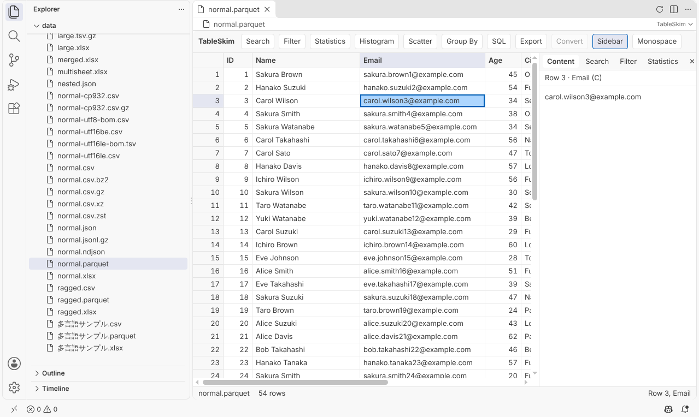
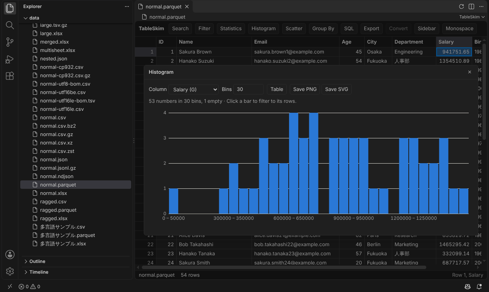
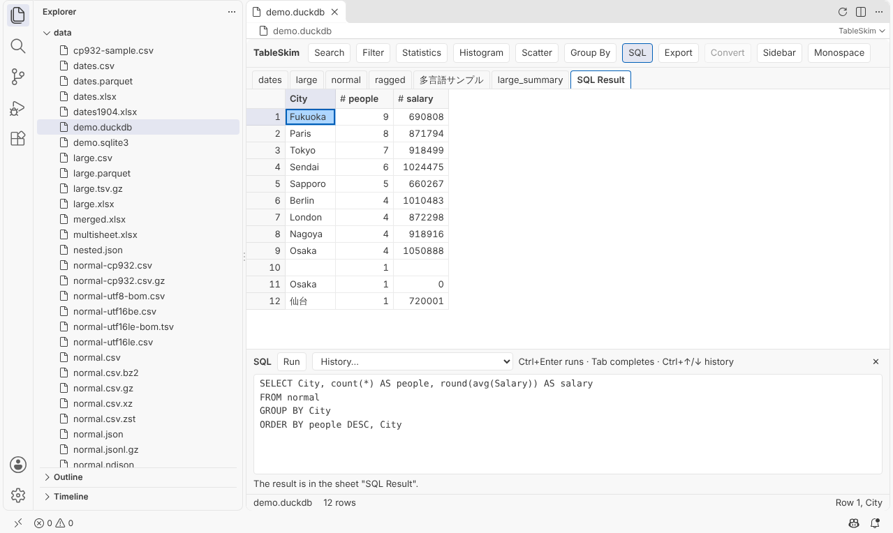

# TableSkim for Visual Studio Code (preview)

View tables in VS Code: CSV, TSV and VCF files (also compressed),
Excel workbooks, Parquet and JSON files, and DuckDB and SQLite databases.
Sort, filter and search them, look at statistics and charts, and run SQL,
without leaving the editor. Large files open at once: rows are read in the
background as you scroll.

This is [TableSkim](https://informationsea.github.io/tableskim/), also
available as a desktop app and a web app, as an editor in VS Code.

## Features

- **Many formats**: CSV, TSV and VCF, compressed with gzip, bzip2, xz or
  zstd too; Excel (`.xlsx`, `.xlsm`); Parquet; JSON and NDJSON; DuckDB and
  SQLite databases, a sheet per table. The text encoding of CSV and TSV
  files (UTF-8, UTF-16 or Shift_JIS / CP932) is detected.
- **Sort and filter**: sort by columns, and filter rows by conditions on
  numbers, dates, text and regular expressions.
- **Search** the whole table, with a list of every hit.
- **Statistics** of a column, **histograms** and **scatter plots**: click a
  bar or a cell of a plot to filter to its rows. Charts are saved as PNG or
  SVG.
- **Group By** columns with counts, sums, means and more.
- **SQL** on DuckDB, SQLite, Parquet and JSON files, with completion and
  history; the result is shown as a sheet of its own.
- **Export** the table as shown (sorted, filtered, columns hidden) to CSV,
  TSV, Excel or Parquet, and convert CSV and TSV files to Parquet or DuckDB.
- **Follows your theme**, light, dark or high contrast.

## Usage

- **Parquet, Excel, DuckDB and SQLite files** open in TableSkim.
- **CSV, TSV, VCF, JSON and compressed files** open as text, as before. To
  view one as a table, right-click it in the Explorer and choose **Open in
  TableSkim**, or choose **Reopen Editor With… > TableSkim** from the
  editor's title bar menu. To always open a kind of file in TableSkim,
  choose **Configure default editor for '\*.csv'…** in the same list.
- **Saving**: exports and chart images go where you choose in a save
  dialog. The file you are viewing is never changed: TableSkim only reads
  it, and its SQL cannot write files.
- **Changes on disk**: when the file changes, TableSkim asks whether to read
  it again. **TableSkim: Reload File** (the refresh button in the editor's
  title bar) reads it again at any time.

The toolbar and the sidebar work as in TableSkim's
[web app](https://informationsea.github.io/tableskim/manual/en/web.html);
see its manual for each feature.

## Where it works

- Files on your computer and, with Remote Development (SSH, WSL, Dev
  Containers), files on the remote machine.
- Restricted Mode (untrusted folders) too, as TableSkim only reads files.
- Not in VS Code for the Web (vscode.dev, github.dev) or virtual
  workspaces: files are read by their paths on disk.

## Good to know

- This is a preview: its features may still change.
- Tables are read-only here; the desktop app can edit CSV, TSV and Excel
  files, and follow a file as it grows.
- Each TableSkim editor reads its file with an engine of its own, which
  takes memory as it reads; close the editors of large files you no longer
  need.

## Feedback and license

Report problems and ideas at
[GitHub Issues](https://github.com/informationsea/tableskim/issues).
TableSkim is free software under the
[GNU Affero General Public License v3.0](https://github.com/informationsea/tableskim/blob/HEAD/LICENSE);
the licenses of the code it includes are in `THIRD_PARTY_LICENSES.txt`.
